# Guida utente di PhotoFlow 0.1.0

Benvenuto! Questa guida ti accompagna passo per passo, dall'installazione alla prima foto ritrovata in un secondo.
Non serve essere esperti di computer: basta sapere come lavori con le tue foto.

---

## Indice

1. [Benvenuto in PhotoFlow](#1-benvenuto-in-photoflow)
2. [Installazione e primo avvio](#2-installazione-e-primo-avvio)
3. [Importare le foto da una scheda SD](#3-importare-le-foto-da-una-scheda-sd)
4. [Scegliere le foto migliori: la Revisione](#4-scegliere-le-foto-migliori-la-revisione)
5. [Ritrovare le foto: la Consultazione](#5-ritrovare-le-foto-la-consultazione)
6. [Persone e volti](#6-persone-e-volti)
7. [Tag, vocabolario e didascalie](#7-tag-vocabolario-e-didascalie)
8. [Duplicati](#8-duplicati)
9. [Lavorare con Lightroom, Bridge e Photoshop](#9-lavorare-con-lightroom-bridge-e-photoshop)
10. [Archivi esistenti: le Librerie](#10-archivi-esistenti-le-librerie)
11. [Impostazioni utili](#11-impostazioni-utili)
12. [Tutte le scorciatoie](#12-tutte-le-scorciatoie)
13. [Se qualcosa non va](#13-se-qualcosa-non-va)

---

## 1. Benvenuto in PhotoFlow

PhotoFlow è un programma per **Windows 10 e 11 (64 bit)** che ti aiuta a **importare, scegliere, taggare e ritrovare** le tue foto.
Usa modelli di intelligenza artificiale che **girano sul tuo PC**: niente cloud, niente account, niente telemetria.
Le tue foto non lasciano mai il computer.

È pensato per chi scatta tanto (eventi, viaggi, motorsport), ha archivi grandi di RAW e JPEG e lavora con Lightroom, Bridge o Photoshop.
Tutto quello che decidi finisce in **file XMP standard**, che quei programmi leggono.


*La Home: i lavori in corso, le foto da rivedere, le tue librerie e le azioni rapide.*

### Cosa ottieni in 5 minuti

1. **Importi** una scheda SD con una copia verificata, file per file.
2. PhotoFlow **segnala** le foto mosse, sfocate, con occhi chiusi o con problemi di esposizione.
3. Nelle **raffiche** ti propone la foto migliore.
4. Tu **decidi con la tastiera**: tieni, scarta, dai le stelle.
5. Con un tasto **scrivi gli XMP**: Lightroom e Bridge vedono subito il tuo lavoro.

Poi, mentre lavori su altro, PhotoFlow aggiunge **tag in italiano e inglese**, riconosce le **persone** e scrive le **didascalie**.

### Le promesse di PhotoFlow

> 💡 **Consiglio**
> Queste regole valgono sempre e non si possono disattivare. Puoi lavorare tranquillo.

- **Non cancella mai le tue foto.** Scarti e duplicati si spostano in cartelle (`_scarti`, `_duplicati`) solo quando lo chiedi tu.
- **Non modifica mai i RAW** (scrive solo il file `.xmp` accanto) e **non tocca mai la scheda SD**.
- **Le tue decisioni restano tue.** Stelle, tag, persone e didascalie scritte da te non vengono mai sovrascritte dalle analisi automatiche.
- **Le impronte dei volti sono cifrate** sul tuo PC.

### Com'è fatta la finestra

- A sinistra c'è la **barra di navigazione**: Home, Job, Revisione, Persone, Consultazione, Duplicati e, in basso, Librerie, Vocabolario, Profili, Impostazioni.
- In alto c'è **Cerca ovunque** (`Ctrl K`).
- In basso c'è la **barra di stato**: mostra **sempre i tasti** della schermata in cui sei. Se dimentichi una scorciatoia, guarda lì.

L'interfaccia è scura (c'è anche il tema chiaro), in italiano e in inglese. Tutto si può fare da tastiera.

---

## 2. Installazione e primo avvio

### Cosa serve

| Risorsa | Minimo | Consigliato |
| --- | --- | --- |
| Sistema | Windows 10 o 11 a 64 bit | Windows 11 |
| Memoria (RAM) | 8 GB | 16 GB o più |
| Scheda video | Non obbligatoria | NVIDIA: molto più veloce |
| Disco | ~1 GB + modelli (da ~0,4 a ~3,5 GB secondo le funzioni) + miniature | SSD |

Per le **didascalie in italiano** serve una scheda NVIDIA con **almeno 12 GB** di memoria.
Mac e Linux non sono ancora disponibili.

### Installare

1. Apri la pagina [Releases di PhotoFlow](https://github.com/foyer-labs/PhotoFlow/releases/latest).
2. Scarica `PhotoFlow-0.1.0-Setup.exe`.
3. Fai doppio clic sul file.
4. Se compare **«Windows ha protetto il PC»**, clicca **«Ulteriori informazioni»** e poi **«Esegui comunque»**.

> ⚠️ **Attenzione**
> L'avviso di SmartScreen compare perché PhotoFlow **non è ancora firmato digitalmente**. Scarica il programma solo dalla pagina Releases ufficiale indicata sopra.

### Il primo avvio

**Passo 1: dove salvare il catalogo.**
Il catalogo contiene le tue decisioni, i tag, le persone e le didascalie. **Non contiene le foto.**

1. PhotoFlow ti propone una cartella sul PC: per usarla clicca **«Usa quella proposta»**.
2. Oppure clicca **«Scegli cartella…»** e indica un'altra cartella, anche di rete.
3. Clicca **«Continua»**.

> 💡 **Consiglio**
> Un disco locale è il più veloce. Una cartella di rete ti permette di usare il catalogo da più PC, **uno alla volta**. Se nella cartella c'è già un catalogo PhotoFlow, viene usato quello. Puoi sempre spostarlo dopo da **Impostazioni › Catalogo**.

**Passo 2: la procedura «Configura PhotoFlow».** Sono tre passi.

1. **Hardware.** PhotoFlow controlla il tuo PC. Se hai una scheda NVIDIA, ti propone il **pacchetto GPU** (le librerie CUDA e cuDNN di NVIDIA). Per scaricarlo devi spuntare tu l'accettazione delle **licenze NVIDIA** e cliccare **«Scarica pacchetto GPU»**. Al termine riavvia PhotoFlow per usare la GPU.
2. **Modelli.** Scegli e scarica i modelli di base (rilevamento del soggetto e volti). Ogni licenza ti viene mostrata **prima** del download e ogni file viene verificato. Per i volti scegli tra:
   - **buffalo_l**: rileva anche gli occhi chiusi, ma è **solo per uso non commerciale**. Devi accettare la sua licenza.
   - **YuNet + SFace**: licenza permissiva, ma **non rileva gli occhi chiusi**.
3. **Prima libreria.** Indica la cartella dove vivono le tue foto. Gli import copieranno qui, ordinati per evento.

Clicca **«Inizia»**. Ora puoi importare una scheda (`Ctrl I`) o aggiungere una cartella di foto in **Librerie**.

> 💡 **Consiglio**
> **Senza scheda NVIDIA funziona tutto**, sulla CPU, solo più lentamente (per alcune funzioni circa un secondo o più per foto).
> **Senza internet?** Puoi installare modelli e pacchetto GPU da una cartella copiata da un altro PC: **«Importa pacchetto offline»**.

### Disinstallare

Usa **«App installate»** di Windows. Vengono rimosse cache e miniature.
**Restano** catalogo, modelli e impostazioni (in `%LOCALAPPDATA%\PhotoFlow` o nella cartella dove hai messo il catalogo).

---

## 3. Importare le foto da una scheda SD

Inserisci la scheda: dopo pochi secondi la Home mostra **«Scheda rilevata»**.
Clicca **«Scegli cosa importare»**. Per importare una cartella invece di una scheda, premi `Ctrl I`.

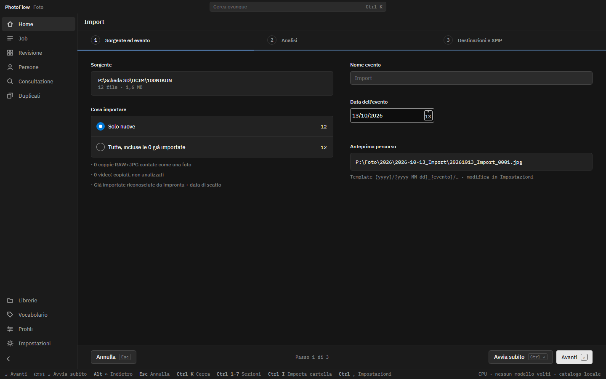

*Il primo passo dell'import: sorgente, cosa importare, nome e data dell'evento, anteprima del percorso.*

### Passo 1: Sorgente ed evento

1. Controlla la **sorgente** (la scheda o la cartella) con il numero di file.
2. In **Cosa importare** lascia **«Solo nuove»**: le foto già importate vengono riconosciute e saltate.
3. Scrivi il **Nome evento** (per esempio «Gara a Monza»).
4. Controlla la **Data dell'evento**: è proposta dagli scatti, ma puoi cambiarla.
5. Guarda l'**Anteprima percorso**: ti mostra dove e con che nome verranno copiati i file. Il modello di nome (anno, data, evento…) si cambia nelle Impostazioni.

Le coppie RAW+JPEG contano come una sola foto. I video vengono copiati ma non analizzati.

### Passo 2: Analisi

1. Scegli il **Profilo di scena**: Eventi, Ritratto, Motorsport, Animali, Paesaggio, Notturna/Aurora o Archivio. Oppure **«Automatico · per gruppo»**: PhotoFlow sceglie il profilo per ogni gruppo di foto.
2. Scegli cosa fare con i **Volti**: Spento, Solo rilevamento (serve per gli occhi chiusi) o Riconoscimento (raggruppa anche le persone).
3. Scegli i **Tag automatici** e le **didascalie** (vedi il [capitolo 7](#7-tag-vocabolario-e-didascalie)).
4. Per il motorsport puoi scegliere un **Elenco iscritti**: vengono riconosciuti solo i numeri in elenco.

### Passo 3: Destinazioni e XMP

1. Controlla la destinazione **Principale**.
2. Con **«+ Aggiungi destinazione»** aggiungi un **Backup** (per esempio un disco esterno) o un **NAS**. PhotoFlow legge la scheda una sola volta e scrive su tutte le destinazioni.
3. Scegli la **Scrittura XMP**. La scelta predefinita, «Incorporati nei JPG, sidecar per i RAW», rende i dati visibili anche in Esplora risorse e in Photoshop.
4. Controlla il **Riepilogo** e clicca **«Avvia import»**.

> 💡 **Consiglio**
> Hai fretta? **«Avvia subito»** (`Ctrl Invio`) parte con le impostazioni ricordate dall'ultima volta.

### Cosa succede durante l'import

- Ogni file copiato viene **riletto e confrontato** con l'originale (controllo xxHash3). Nessuna analisi parte su un file non verificato.
- Se l'import si interrompe, **riprende** da dove era rimasto.
- Se la scheda o una destinazione si scollega durante la copia, il lavoro va in **pausa**: ricollegala e **riprendi** dalla sezione Job.
- Puoi seguire l'avanzamento nella sezione **Job**.

> ⚠️ **Attenzione**
> **La scheda non viene mai modificata né svuotata.** Formattala tu, nella fotocamera, quando sei sicuro che la copia (e il backup) sono a posto.

---

## 4. Scegliere le foto migliori: la Revisione

Dopo l'import apri **Revisione** (o clicca **«Apri revisione»** nella Home).

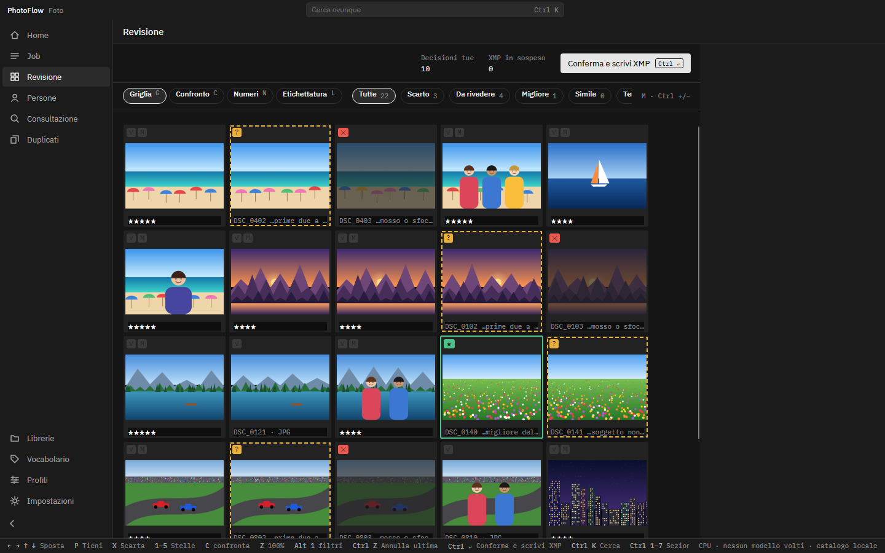

*La Revisione: ogni miniatura mostra l'esito proposto. Rosso = scarto, giallo tratteggiato = da rivedere, verde = migliore.*

### Gli esiti

| Esito | Come lo riconosci | Cosa significa |
| --- | --- | --- |
| **Scarto** | ✕ rosso, foto attenuata | Problema tecnico certo (per esempio mosso grave) |
| **Da rivedere** | ? giallo, cornice tratteggiata | PhotoFlow non è sicuro: decidi tu |
| **Migliore** | ★ verde, cornice piena | La foto migliore della raffica |
| **Simile** | ≈ viola | Valida, ma non la prima della raffica |
| **Tenuta** | ✓ | Scatto singolo senza problemi |

PhotoFlow raggruppa le **raffiche** e propone la migliore. Riconosce anche **bracketing** e **timelapse**, che non tratta come raffiche.
Se due foto sono quasi alla pari, le segna entrambe «da rivedere».

> 💡 **Consiglio**
> PhotoFlow scarta solo quando è **davvero sicuro**. Nel dubbio segna «da rivedere». In **modalità prudente** gli scarti diventano solo un'etichetta rossa, non un rating −1. La modalità si sceglie in **Impostazioni › Culling**.

### Come decidere

1. Muoviti tra le foto con le **frecce**.
2. Premi `P` per **tenere** una foto, `X` per **scartarla**, da `1` a `5` per le **stelle** (`0` le toglie).
3. Premi `C` per **confrontare** le foto affiancate e `Z` per lo **zoom al 100%**.
4. Hai sbagliato? `Ctrl Z` **annulla**.
5. Usa i filtri in alto (Tutte, Scarto, Da rivedere, Migliore, Simile…) per vedere un esito alla volta.
6. Quando hai finito premi `Ctrl Invio`: **Conferma e scrivi XMP**.

Una finestra ti chiede conferma con il numero esatto di foto. Le foto ancora «da rivedere» vengono scritte con l'etichetta rossa.
I RAW non vengono modificati e nessun file viene spostato.

> 💡 **Consiglio**
> Puoi iniziare a decidere **mentre l'analisi è ancora in corso**: le tue scelte prevalgono sempre sulle proposte.

### Tasti della Revisione

| Tasto | Azione |
| --- | --- |
| `←` `→` `↑` `↓` | Spostati tra le foto |
| `P` | Tieni |
| `X` | Scarta |
| `1`-`5` | Stelle (`0` le toglie) |
| `C` | Confronta |
| `Z` | Zoom 100% |
| `Ctrl +` / `Ctrl −` | Miniature più grandi / più piccole |
| `Ctrl Z` | Annulla |
| `Ctrl Invio` | Conferma e scrivi XMP |

### Spostare gli scarti

Gli scarti restano dove sono finché non lo chiedi tu.
Con **«Sposta scarti…»** finiscono in una cartella `_scarti` della loro libreria, con il loro sidecar. **Nulla viene eliminato.**

### Motorsport: la vista Numeri

Con il profilo **Motorsport** PhotoFlow legge i **numeri di gara** su auto e moto.
Con un elenco iscritti accetta solo i numeri in elenco e ignora sponsor e targhe.
Premi `N` nella Revisione per aprire la vista **Numeri** e correggere le letture in dubbio (per esempio «6 o 9»): digita il numero con `0`-`9` e premi `Invio` per confermare e andare avanti; `Canc` significa «nessun numero».

### Le altre viste

- **Griglia** (`G`): la vista di tutti i giorni.
- **Confronto** (`C`): 2-4 foto affiancate.
- **Numeri** (`N`): i numeri di gara.
- **Etichettatura** (`L`): una modalità facoltativa in cui etichetti le foto «alla cieca», per misurare quanto PhotoFlow ci azzecca.

---

## 5. Ritrovare le foto: la Consultazione

Apri **Consultazione**. Qui trovi tutte le foto del catalogo.

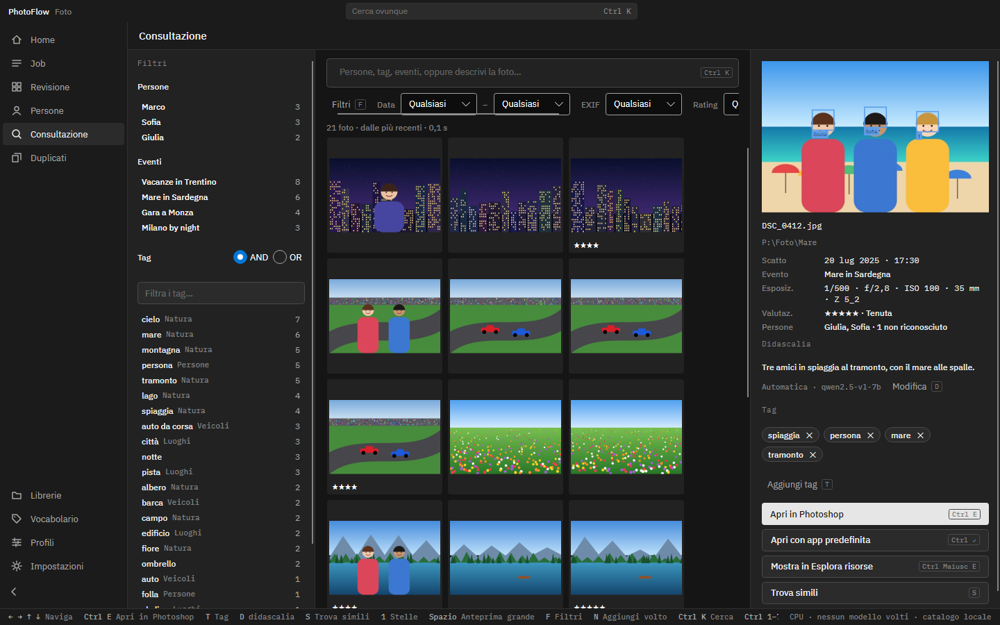

*La Consultazione: a sinistra i Filtri con i conteggi, al centro la griglia, a destra i dettagli della foto con didascalia e tag.*

### Cercare a parole

1. Clicca nel campo in alto (o premi `Ctrl K`).
2. Scrivi una **persona**, un **tag** o un **evento**: diventa un «gettone» e filtra in modo esatto.
3. Oppure **descrivi la foto** con parole tue, per esempio *bambini che ridono al tramonto*. PhotoFlow ordina le foto per significato.

Puoi anche filtrare per **data**, **fotocamera ed EXIF**, **stelle** ed **esito**.

### Il pannello Filtri

Premi `F` per aprire o chiudere il pannello. Ha tre sezioni, ognuna con il **numero di foto** accanto a ogni voce:

- **Persone**: le persone scelte devono esserci **tutte** nella foto.
- **Eventi**: sono alternativi tra loro (una foto appartiene a un evento o all'altro).
- **Tag**: si combinano in **AND** oppure in **OR**.

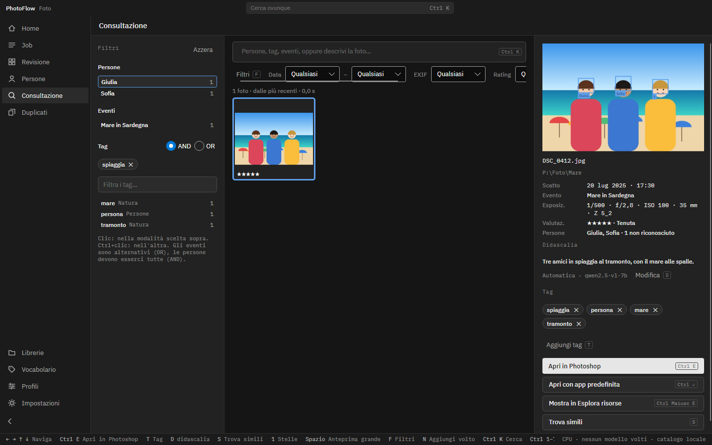

*Giulia + tag «spiaggia»: resta una sola foto.*

**Come combinare i tag**

1. Scegli in alto **AND** oppure **OR**.
2. In **AND**, ogni tag che clicchi **restringe** il risultato. Il numero accanto ti dice quante foto restano.
3. In **OR**, ogni tag che clicchi **aggiunge** foto. Il numero «+N» ti dice quante se ne aggiungono.
4. `Ctrl`+clic fa l'azione dell'altra modalità.
5. Per togliere un tag, clicca la ✕ sul suo gettone.

Esempio: scegli **auto** e **moto** in OR, poi **pista** in AND. Ottieni *(auto OR moto) AND pista*.

> 💡 **Consiglio**
> Usa la casella **«Filtra i tag…»** per trovare subito un tag in un elenco lungo. **«Azzera»** toglie tutti i filtri.

### L'anteprima grande

1. Seleziona una foto e premi `Spazio` (o fai doppio clic).
2. Con `←` `→` passi alle altre foto.
3. Con `Esc`, `Spazio` o doppio clic torni all'elenco.

### Cosa puoi fare con una foto

| Tasto | Azione |
| --- | --- |
| `1`-`5` | Stelle |
| `T` | Aggiungi un tag |
| `D` | Scrivi o modifica la didascalia |
| `S` | Trova simili |
| `Ctrl E` | Apri in Photoshop |
| `Ctrl Invio` | Apri con l'app predefinita |
| `Ctrl Maiusc E` | Mostra in Esplora risorse |

---

## 6. Persone e volti

PhotoFlow trova i volti e li **raggruppa**. Tu dai i nomi **una volta sola**: poi riconosce le persone nelle nuove foto.

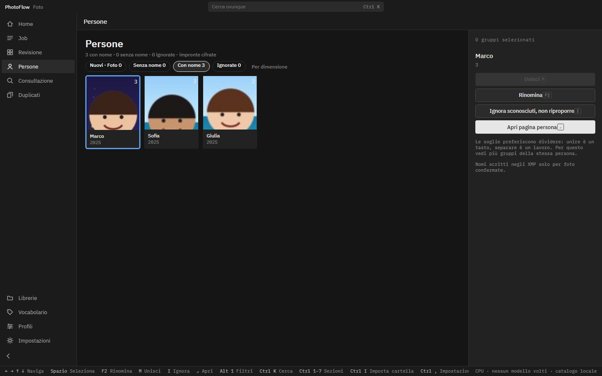

*Persone: i gruppi con nome. In alto i filtri Nuovi, Senza nome, Con nome, Ignorate.*

### Dare un nome

1. Apri **Persone**.
2. Seleziona un gruppo (frecce, `Spazio` per selezionare).
3. Premi `F2` (**Rinomina**) e scrivi il nome.

### Unire, ignorare, separare

- **Unire.** Se la stessa persona è divisa in due gruppi, selezionali entrambi e premi `M` (**Unisci**). PhotoFlow preferisce dividere, perché unire è un tasto, separare è un lavoro.
- **Ignorare.** Per sconosciuti che non ti interessano premi `I` (**Ignora sconosciuti, non riproporre**).
- **Aprire la pagina** di una persona: `Invio`.

### La pagina di una persona

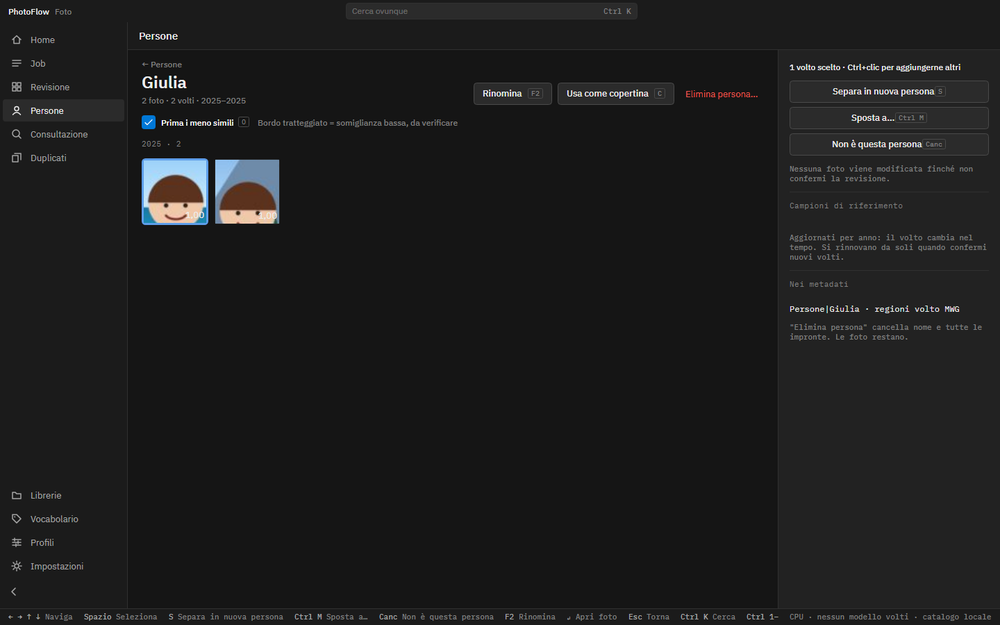

*La pagina di Giulia: i suoi volti divisi per anno. «Prima i meno simili» mette in cima quelli da controllare.*

Qui controlli i volti uno per uno. Un bordo tratteggiato indica una somiglianza bassa: verificalo.

1. Seleziona un volto (`Ctrl`+clic per sceglierne altri).
2. Poi scegli cosa fare:
   - `S` **Separa in nuova persona**: i volti scelti diventano una persona nuova.
   - `Ctrl M` **Sposta a…**: scegli la persona giusta dall'elenco.
   - `Canc` **Non è questa persona**.
   - `C` **Usa come copertina**.
3. Premi `Invio` (o doppio clic) per **Apri foto**.

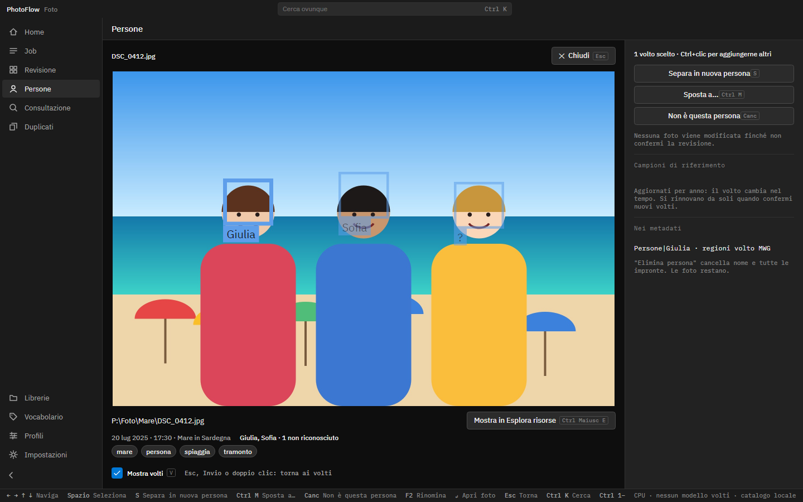

*Apri foto: la foto intera con i riquadri dei volti, il percorso del file, i tag e «Mostra in Esplora risorse».*

Con `Esc`, `Invio` o doppio clic torni ai volti. `V` mostra o nasconde i riquadri.

> ⚠️ **Attenzione**
> In questa versione **unire, separare e rinominare non si annullano** con `Ctrl Z`. Controlla bene prima.
> **«Elimina persona…»** cancella il nome e tutte le impronte di quella persona. Le foto restano.

### Volti sulla foto: «chi è?»

Nell'anteprima grande della Consultazione (`Spazio`) ogni volto ha un riquadro con il nome. Un volto non riconosciuto mostra **«?»**.

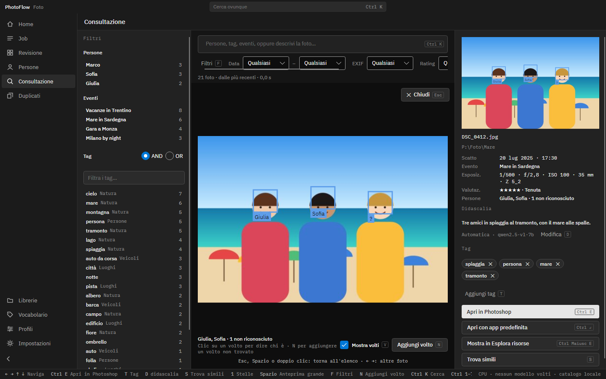

*Giulia e Sofia riconosciute, il terzo volto è «?». In basso: «Mostra volti» e «Aggiungi volto».*

**Dire chi è un volto**

1. Clicca sul riquadro (un «?» o un nome sbagliato).
2. Scegli la persona dall'elenco.

Da quel momento PhotoFlow usa quel volto per riconoscere meglio la persona anche nelle altre foto.

**Aggiungere un volto non trovato**

1. Premi `N` (**Aggiungi volto**).
2. Trascina un riquadro sul volto.
3. Scegli la persona dall'elenco (in ordine alfabetico) oppure **«+ Nuova persona…»**.

Il volto aggiunto a mano finisce nell'XMP con il nome, ma non aiuta a riconoscere la persona in altre foto.

> 💡 **Consiglio**
> I nomi delle persone vengono scritti negli XMP **solo per le foto confermate** in Revisione. Le impronte dei volti sono **cifrate** e legate al tuo account Windows.

---

## 7. Tag, vocabolario e didascalie

### I tag automatici

PhotoFlow aggiunge tag **in italiano e in inglese**, ordinati in categorie (Natura, Luoghi, Veicoli, Persone, Eventi, Animali).
Nell'import scegli quali usare:

- **A · Vocabolario personale**: i tuoi tag personali.
- **B · Tag generici**: migliaia di tag pronti. È più pesante: senza GPU serve circa un secondo per foto.

Nella Consultazione puoi aggiungere un tag con `T` o toglierlo con la ✕.
Un tag automatico che hai tolto **non viene più rimesso** dalle analisi successive.

### Il Vocabolario

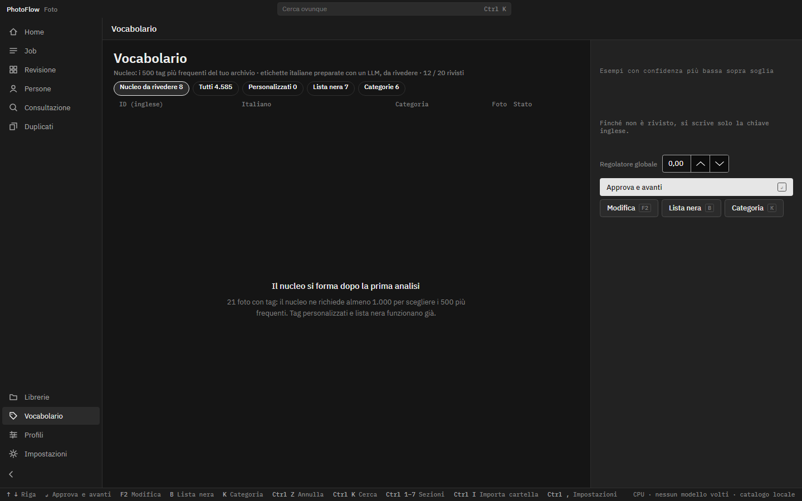

*Il Vocabolario: nucleo da rivedere, tutti i tag, personalizzati, lista nera e categorie.*

- **Nucleo da rivedere.** I 500 tag più frequenti del tuo archivio. Compare dopo almeno **1.000 foto con tag**. Rivedi le traduzioni riga per riga: `Invio` approva e va avanti, `F2` modifica, `B` lista nera, `K` categoria, `Ctrl Z` annulla.
- **Lista nera.** Tag inutili (per esempio «image», «photo») che non vengono mai scritti.
- **Personalizzati.** Crea tag tuoi **descrivendoli a parole**. «Prova sull'archivio» conta quante foto lo riceverebbero senza salvare; «Salva e rianalizza» lo applica.

> 💡 **Consiglio**
> Finché un tag non è rivisto, negli XMP viene scritto solo in inglese. Rivedere il nucleo rende le tue parole chiave italiane complete.

### Le didascalie

Una didascalia è una breve frase che descrive la foto. Si cerca anche a parole nella Consultazione.

- **In inglese** (livello C, Florence-2): sceglilo nell'import. Circa un secondo per foto con la GPU, qualche secondo su CPU.
- **In italiano** (livello D, Qwen3.5-9B): solo con una scheda **NVIDIA da almeno 12 GB** e il pacchetto GPU installato.

**Attivare le didascalie in italiano** (una volta sola)

1. Apri **Impostazioni › Modelli** e trova il modello Qwen3.5-9B.
2. Segui le istruzioni: scarica da Hugging Face i file originali (Qwen/Qwen3.5-9B, circa 18 GB) nella cartella indicata (**«Apri cartella»**).
3. Clicca **«Verifica e converti»**. Serve Python 3.10-3.13 installato sul PC.
4. Aspetta **10-30 minuti**. Servono circa **45 GB liberi** durante la conversione.
5. Quando vedi **«Convertito ✓»**, scegli il livello D nell'import.

Le didascalie in italiano si creano in una passata **alla fine del lavoro**, circa un secondo per foto.

> 💡 **Consiglio**
> Hai già convertito il modello precedente, **Qwen2.5-VL-7B**? PhotoFlow continua a usarlo: il modello delle didascalie non cambia mai da solo. Quando hai convertito Qwen3.5-9B, premi **«Usa questo modello»**: PhotoFlow ti propone di rigenerare le didascalie automatiche (le tue restano).

Per scrivere o correggere una didascalia premi `D` nella Consultazione (`Invio` salva, `Esc` annulla).

> 💡 **Consiglio**
> **La didascalia scritta da te non viene mai sovrascritta.** Nel pannello dettagli vedi se è «Scritta da te» o «Automatica».

---

## 8. Duplicati

Apri **Duplicati**. PhotoFlow cerca:

- **Copie esatte**: lo stesso file in cartelle diverse della stessa libreria.
- **Quasi-duplicati**: foto quasi identiche (servono il modello CLIP, da **Impostazioni › Modelli**).

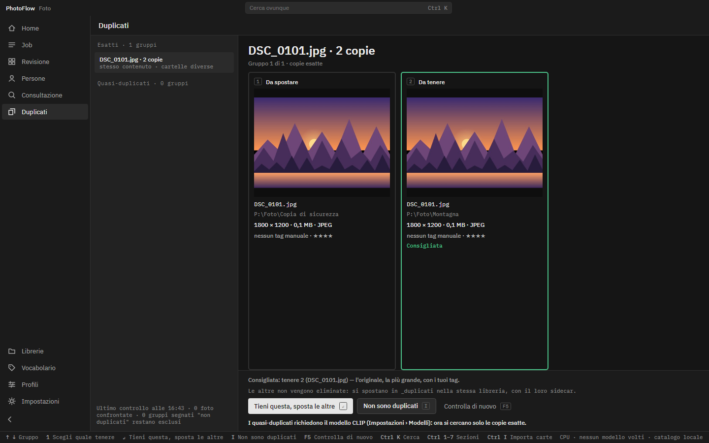

*Due copie dello stesso file: PhotoFlow consiglia quale tenere (l'originale, la più grande, con i tuoi tag).*

1. Scegli un gruppo dall'elenco a sinistra (`↑` `↓`).
2. Clicca la copia da tenere, oppure premi il suo numero (`1`-`4`).
3. Premi `Invio`: **Tieni questa, sposta le altre**.

Non sono duplicati? Premi `I`: il gruppo non verrà più proposto. `F5` ricontrolla.

> 💡 **Consiglio**
> Le altre copie **non vengono eliminate**: si spostano nella cartella `_duplicati` della stessa libreria, con il loro sidecar. Le librerie in sola lettura restano intatte.

---

## 9. Lavorare con Lightroom, Bridge e Photoshop

PhotoFlow scrive il tuo lavoro in **XMP standard**. Lightroom, Bridge e Photoshop lo leggono.

| Cosa | Dove finisce |
| --- | --- |
| Stelle | Rating |
| Scarto | Rating −1 (in modalità prudente: etichetta rossa) |
| Da rivedere | Etichetta rossa |
| Tag | Parole chiave (italiano + inglese) e parole chiave gerarchiche (es. `Natura\|mare`) |
| Persone | Regioni dei volti con il nome e parola chiave `Persone\|Nome` |
| Didascalia | Descrizione (facoltativa) |

### Come vengono scritti

- I **RAW non vengono mai modificati**: i dati vanno nel file `.xmp` accanto (sidecar).
- Per i JPG di un import, la scelta predefinita scrive i dati **dentro il file**. Così li vedi anche in Esplora risorse, che ignora i sidecar.
- Gli XMP si scrivono **solo dopo la conferma** in Revisione.
- Le didascalie si scrivono negli XMP solo se lo attivi: **Impostazioni › Generali › XMP › «Scrivi le didascalie in dc:description»**.

### Se modifichi le foto in Bridge o Lightroom

Le modifiche fatte altrove (stelle, etichette, parole chiave, descrizione) vengono **reimportate** in PhotoFlow come tue, all'avvio e prima di ogni scrittura.
Su stelle ed etichette vince la modifica **più recente**.
Puoi forzare il controllo con **«Sincronizza ora»** in Impostazioni › Generali › XMP. Da lì puoi anche importare le persone già nominate in altri programmi.

### Aprire una foto in Photoshop

Nella Consultazione seleziona la foto e premi `Ctrl E`.

---

## 10. Archivi esistenti: le Librerie

Hai già migliaia di foto in cartelle? Aggiungile come **libreria**.
PhotoFlow le analizza **sul posto**: non sposta nulla.

1. Apri **Librerie**.
2. Clicca **«Nuova libreria»** e scegli la cartella.
3. Scegli come scrivere i metadati:
   - **Sidecar XMP** (consigliato): gli originali non vengono mai toccati.
   - **Solo catalogo**: nulla viene scritto accanto alle foto.
   - Se vuoi, spunta anche **Sola lettura**: nulla viene scritto accanto alle foto e decisioni e tag restano nel catalogo.
4. Scegli l'ordine: **dalle più recenti** o **per cartella**.
5. Clicca **«Avvia analisi»**.

L'analisi gira **in background, a bassa priorità**, e cede il passo agli import. Puoi metterla in pausa e riprenderla.

> ⚠️ **Attenzione**
> Puoi chiedere di scrivere l'XMP **dentro** i file non RAW di una libreria. PhotoFlow ti chiede conferma con il numero di file coinvolti e conserva una copia `_original` di ogni file prima di scrivere.

> 💡 **Consiglio**
> Su un archivio grande, dopo la prima analisi, apri **Persone** e dai un nome ai gruppi più grandi: è il modo più veloce per ritrovare tutti.

---

## 11. Impostazioni utili

Apri le Impostazioni con `Ctrl ,`. Le schede sono: Hardware, Modelli, Catalogo, Generali, Culling (`Ctrl Tab` passa alla successiva).

### Modelli

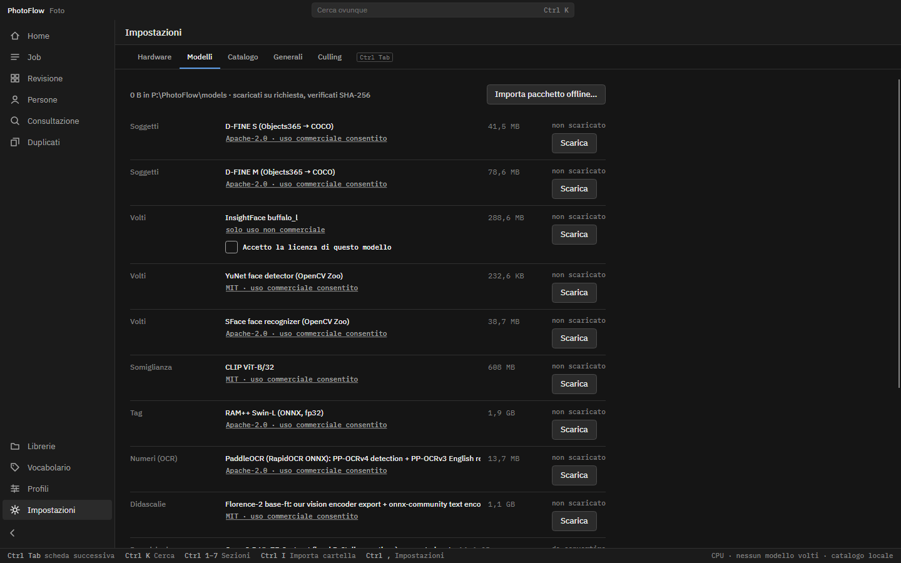

*Impostazioni › Modelli: per ogni funzione il modello, la licenza, lo spazio e il pulsante «Scarica».*

- Ogni modello mostra la **licenza** prima del download. Quelli non commerciali sono contrassegnati.
- I file vengono **verificati** (SHA-256).
- **«Importa pacchetto offline…»** installa modelli e pacchetto GPU da una cartella copiata da un altro PC.
- **«Usa questo modello»** cambia il modello in uso per una funzione.
- **Riconoscimento delle persone.** Qui scegli il modello che crea le impronte dei volti: ArcFace (in buffalo_l), SFace oppure **AdaFace IR-101**, opzionale e più preciso sui volti piccoli o sfocati. AdaFace è solo per uso **non commerciale**: spunta l'accettazione della licenza, premi **«Scarica i file originali»** e poi **«Verifica e converti»** (pochi minuti, anche senza GPU; serve Python 3.10-3.13 già installato). Scelto il modello, **«Usa e rigenera i volti»** apre la rigenerazione dei volti su tutto il catalogo.

**Rigenerare i risultati.** Quando cambi modello, PhotoFlow può rifare le analisi.

1. Parti da **«Rigenera…»** in Librerie o da **«Rigenera i risultati…»** in Consultazione.
2. Prova prima su un **campione** di foto.
3. Guarda l'**anteprima delle differenze**.
4. Scegli **«Applica»** o **«Scarta»**.

Le tue decisioni, i tuoi tag e i nomi che hai dato restano sempre.

Nel perimetro puoi scegliere anche **«Tutto il catalogo»**. Se rigeneri i volti puoi spuntare **«Riparti da zero con le persone»**: PhotoFlow ti mostra quante persone, assegnazioni fatte a mano e volti disegnati verranno eliminati, e devi confermare con **«Sì, elimina tutte le persone»**.

> ⚠️ **Attenzione**
> L'azzeramento vale per **tutto il catalogo**, anche per le persone con nome e le assegnazioni fatte a mano. Avviene solo quando applichi la rigenerazione completa, mai con la prova su campione. Prima PhotoFlow fa un backup del catalogo: per tornare indietro usa **Impostazioni › Catalogo › «Ripristina…»**. Dagli XMP già scritti spariscono i nomi e le aree dei volti messi da PhotoFlow; quelli di altri programmi restano.

### Catalogo

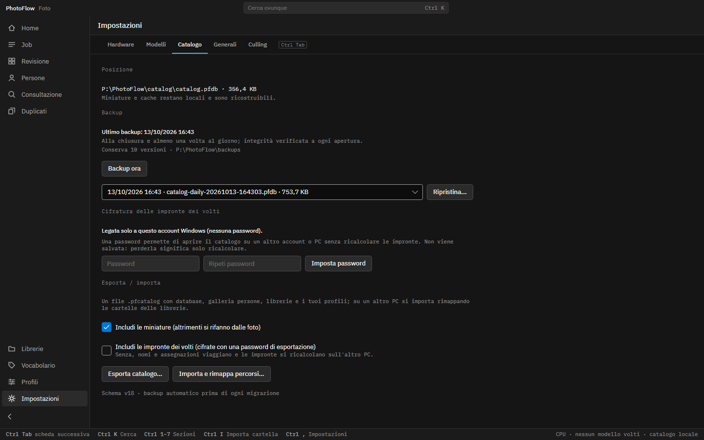

*Impostazioni › Catalogo: posizione, backup, cifratura delle impronte, esportazione e importazione.*

- **Posizione.** «Sposta…» copia il catalogo in un'altra cartella. «Apri un catalogo esistente…» ne usa un altro. Entrambi valgono **dal prossimo avvio** e il catalogo di prima resta dov'era.
- **Backup.** Automatici alla chiusura e almeno una volta al giorno; si tengono gli ultimi 10. «Backup ora» ne fa uno subito; «Ripristina…» torna a un backup al prossimo avvio.
- **Cifratura delle impronte.** Di base è legata al tuo account Windows. Con una password puoi aprire il catalogo su un altro account o PC senza ricalcolare le impronte.
- **Esporta / importa.** «Esporta catalogo…» crea un file `.pfcatalog` da portare su un altro PC. «Importa e rimappa percorsi…» lo apre e ti chiede dove sono ora le cartelle delle librerie.

> ⚠️ **Attenzione**
> La password delle impronte **non viene salvata**. Se la perdi, nulla è perduto: le impronte si ricalcolano, nomi e assegnazioni restano.
> Un catalogo in rete si apre **da un PC alla volta**.

### Generali: aggiornamenti

PhotoFlow controlla all'avvio se c'è una nuova versione e te lo dice nella barra di stato.

1. Apri **Impostazioni › Generali › Aggiornamenti**.
2. Clicca **«Controlla ora»**, se vuoi.
3. Clicca **«Scarica, installa e riavvia»**.

L'aggiornamento non parte mai durante un lavoro in corso. Catalogo, modelli e impostazioni restano come sono.
Se non vuoi il controllo automatico, togli la spunta a **«Cerca una nuova versione all'avvio»**.

### Altre impostazioni

- **Hardware**: scheda video, pacchetto GPU, prova di velocità.
- **Culling**: modalità prudente o normale.
- **Lingua**: italiano o inglese (si applica al riavvio).
- **Profili** (nella barra a sinistra): duplica un profilo di scena e adattalo a te. I profili predefiniti restano intatti.

---

## 12. Tutte le scorciatoie

La barra di stato in basso mostra sempre i tasti della schermata. Ecco l'elenco completo dei principali.

### Ovunque

| Tasto | Azione |
| --- | --- |
| `Ctrl 1`-`7` | Passa da una sezione all'altra: `1` Home · `2` Job · `3` Revisione · `4` Persone · `5` Consultazione · `6` Duplicati · `7` Librerie |
| `Ctrl K` | Cerca ovunque |
| `Ctrl I` | Importa cartella |
| `Ctrl ,` | Impostazioni |

### Import

| Tasto | Azione |
| --- | --- |
| `Invio` | Avanti |
| `Alt ←` | Indietro |
| `Ctrl Invio` | Avvia subito con le impostazioni ricordate |
| `Esc` | Annulla |

### Revisione

| Tasto | Azione |
| --- | --- |
| `←` `→` `↑` `↓` | Spostati tra le foto |
| `P` | Tieni |
| `X` | Scarta |
| `1`-`5` | Stelle (`0` le toglie) |
| `C` | Confronta |
| `Z` | Zoom 100% |
| `G` / `N` / `L` | Griglia / Numeri / Etichettatura |
| `Ctrl Z` | Annulla |
| `Ctrl Invio` | Conferma e scrivi XMP |

### Numeri (motorsport)

| Tasto | Azione |
| --- | --- |
| `0`-`9` | Digita il numero |
| `Invio` | Conferma e vai avanti |
| `Canc` | Nessun numero |

### Consultazione

| Tasto | Azione |
| --- | --- |
| `F` | Apri/chiudi i Filtri |
| `Spazio` | Anteprima grande (`Esc` per tornare) |
| `V` | Mostra/nascondi i riquadri dei volti |
| `N` | Aggiungi un volto |
| `T` | Aggiungi un tag |
| `D` | Didascalia |
| `S` | Trova simili |
| `1`-`5` | Stelle |
| `Ctrl E` | Apri in Photoshop |
| `Ctrl Invio` | Apri con l'app predefinita |
| `Ctrl Maiusc E` | Mostra in Esplora risorse |

### Persone

| Tasto | Azione |
| --- | --- |
| `F2` | Rinomina |
| `M` | Unisci |
| `I` | Ignora |
| `S` | Separa in nuova persona |
| `Canc` | Non è questa persona |
| `Ctrl M` | Sposta a… |
| `Invio` | Apri (pagina persona o foto) |

### Vocabolario

| Tasto | Azione |
| --- | --- |
| `Invio` | Approva e avanti |
| `F2` | Modifica |
| `B` | Lista nera |
| `K` | Categoria |
| `Ctrl Z` | Annulla |

### Duplicati

| Tasto | Azione |
| --- | --- |
| `1`-`4` | Scegli quale tenere (o clic) |
| `Invio` | Tieni questa, sposta le altre |
| `I` | Non sono duplicati |
| `F5` | Controlla di nuovo |

> 💡 **Consiglio**
> Le lettere non agiscono mentre scrivi in un campo di testo, come la ricerca. Non rischi di scartare una foto mentre digiti.

---

## 13. Se qualcosa non va

### Problemi comuni

| Cosa vedi | Cosa fare |
| --- | --- |
| «Windows ha protetto il PC» all'installazione | Clicca «Ulteriori informazioni» e poi «Esegui comunque». Il programma non è ancora firmato. |
| Una funzione dice che manca un modello | Apri **Impostazioni › Modelli** e scarica il modello indicato. |
| La scheda NVIDIA non viene usata | Controlla in **Impostazioni › Hardware** che il pacchetto GPU sia installato, poi riavvia PhotoFlow. |
| Il catalogo in rete non si apre | Probabilmente è aperto su un altro PC: chiudi PhotoFlow là e riprova. |
| PhotoFlow si è chiuso all'improvviso | Riaprilo: ti propone di **riprendere** i lavori interrotti. |
| Il catalogo risulta danneggiato | All'apertura PhotoFlow propone il ripristino dall'ultimo backup. |
| Un disco di destinazione si è scollegato | Il job va in pausa: ricollega il disco e scegli «Riprendi» nella sezione Job. |
| Un XMP non è stato scritto (es. cartella in sola lettura) | La decisione è salva nel catalogo; la scrittura resta in sospeso e viene ritentata. |
| Persone: il riconoscimento è sospeso | La chiave delle impronte non è disponibile (altro account o PC): scegli «Inserisci password» o «Ricalcola impronte». Nomi e assegnazioni restano. |
| Errore su un singolo file | Il lavoro non si ferma: il motivo viene registrato e puoi riprovare. |

### Dove sono i log

I log sono file di testo sul tuo PC, in:

```
%LOCALAPPDATA%\PhotoFlow\logs
```

Per aprirli:

1. Premi `Win R`.
2. Incolla `%LOCALAPPDATA%\PhotoFlow\logs` e premi `Invio`.

I log non contengono impronte dei volti né chiavi. Prima di condividerli, dai comunque un'occhiata.

### Chiedere aiuto

- Leggi le [domande frequenti (FAQ)](faq.md).
- Se il problema resta, segnalalo sul repository di PhotoFlow: https://github.com/foyer-labs/PhotoFlow. Descrivi cosa stavi facendo e allega il log, se puoi.

> 💡 **Consiglio**
> PhotoFlow 0.1.0 è la prima versione pubblica: funziona, ma è giovane. Le tue segnalazioni aiutano a migliorarlo.

---

*PhotoFlow è open source (licenza Apache 2.0), sviluppato da Foyer Labs. Le persone negli screenshot (Giulia, Marco, Sofia) sono personaggi inventati, disegnati come figure stilizzate.*
