# PhotoFlow Studio — il flusso operativo

Come si lavora con PhotoFlow Studio, dalla scheda SD alla consegna, e perché le schermate sono in
quest'ordine. Le scelte di progetto sono in [`progetto.md`](progetto.md) (decisioni S1–S13). Gli
screenshot vengono dall'interfaccia vera, su un catalogo dimostrativo di immagini disegnate: nessuna foto
e nessun volto reale.

## In una riga

**Importa → Scegli → Sviluppa → Consegna**, con l'archivio (persone, ricerca, duplicati) sempre a
disposizione. La barra laterale ha lo stesso ordine e i tasti Ctrl 1–9 lo seguono.

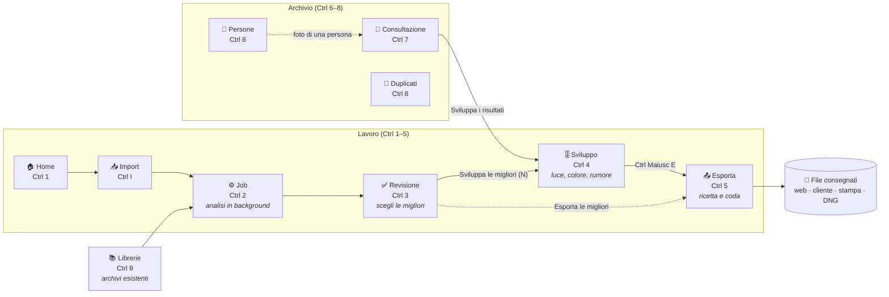

Tre regole tengono insieme il flusso:

1. **Prima si sceglie, poi si sviluppa.** Il culling è rapido e intuitivo, lo sviluppo è lento e
   analitico: non si mescolano. La riduzione del rumore costa secondi a foto e non va spesa sugli scarti.
2. **Il programma propone il passo dopo, una volta e senza finestre.** Alla fine della Revisione compare
   «Sviluppa le migliori (N)»; in Sviluppo, Ctrl Maiusc E porta all'esportazione. Tutte le sezioni restano
   raggiungibili in ogni momento: è un tunnel che non imprigiona.
3. **Una selezione di lavoro condivisa.** Le foto mandate allo Sviluppo seguono l'utente fino a Esporta
   e dicono sempre da dove vengono («Da Revisione · Mare in Sardegna · 8 foto»).

## La vita di una foto

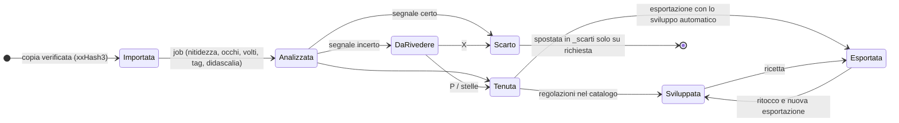

L'originale non cambia mai: la scheda SD non viene toccata, i RAW ricevono solo un sidecar `.xmp`
(stelle, tag, persone), lo sviluppo vive nel catalogo e finisce solo nei file esportati.

## Passo per passo

### 1. Home — da dove si parte

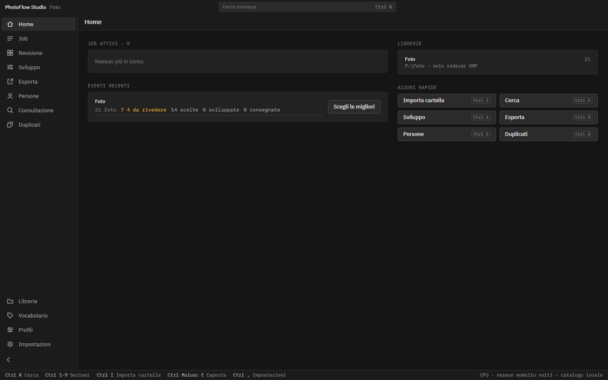

La Home dice cosa c'è da fare: i job in corso, gli **eventi recenti** con a che punto sono (da decidere,
scelte, sviluppate, consegnate) e il pulsante del passo successivo («Scegli le migliori», «Sviluppa»,
«Consegna»), le librerie e le azioni rapide nell'ordine del lavoro. Con la scheda inserita la Home dice
anche se è **al sicuro**: quando tutte le foto sono nel catalogo e verificate in almeno due posti si può
formattarla nella fotocamera, e «Espelli» la toglie. Al primo avvio una procedura guidata chiede dove
tenere il catalogo e quali modelli scaricare, mostrando ogni licenza.

### 2. Import e Job — copiare senza paura, analizzare in background

Si sceglie la scheda o la cartella, il nome dell'evento e lo schema dei nomi. PhotoFlow Studio copia,
**ricontrolla ogni file**, salta quelli già importati e avvia il job: raffiche, nitidezza, occhi chiusi,
esposizione, volti, tag in italiano e inglese, didascalie. Si può continuare a lavorare mentre gira.

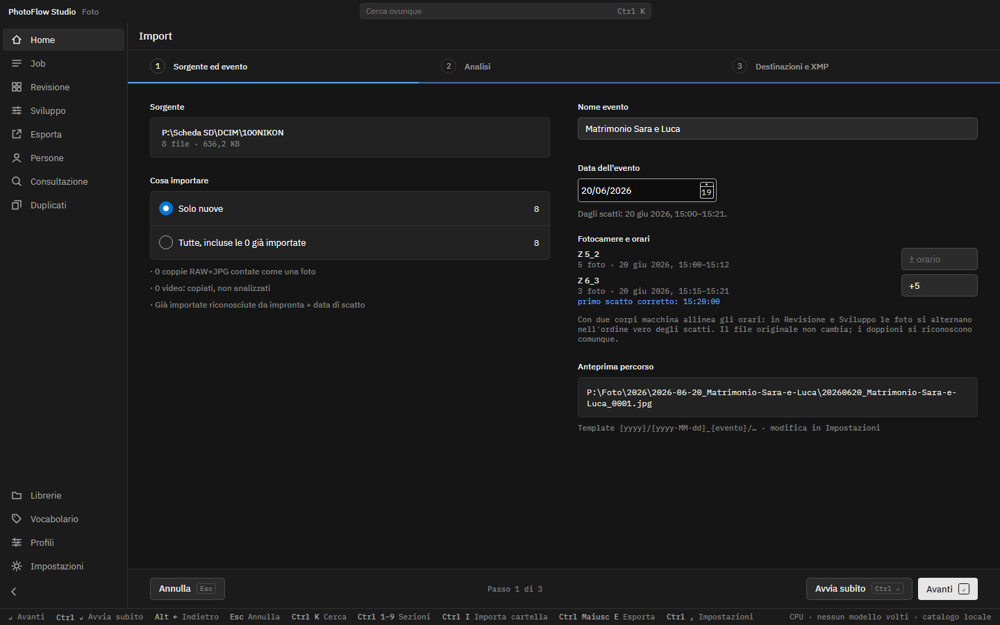

Con **due corpi macchina** l'import elenca le fotocamere della scheda: si corregge l'orario di quella che è
indietro («+5») e in Revisione e Sviluppo gli scatti si alternano nell'ordine vero. La seconda scheda dello
stesso evento si aggiunge e la numerazione continua.

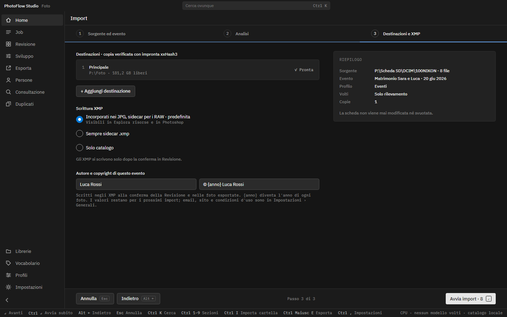

Al passo 3, accanto alle destinazioni, **autore e copyright** dell'evento («© {anno} Nome Cognome»): vanno
negli XMP alla conferma della Revisione e in ogni foto consegnata.

### 3. Revisione — scegliere le migliori

Il primo giro l'ha fatto il programma: rosso per gli scarti certi, giallo per le foto da rivedere, verde
per la migliore di ogni raffica, con il motivo di ogni proposta. L'ultima parola è dell'utente, tutta da
tastiera: **P** tieni, **X** scarta, **1–5** stelle, **C** confronta, **Spazio** foto grande.

Quando le scelte ci sono, nell'intestazione compare **«Sviluppa le migliori (N)»**: le migliori e le
tenute del job diventano la selezione di lavoro e si apre lo Sviluppo.

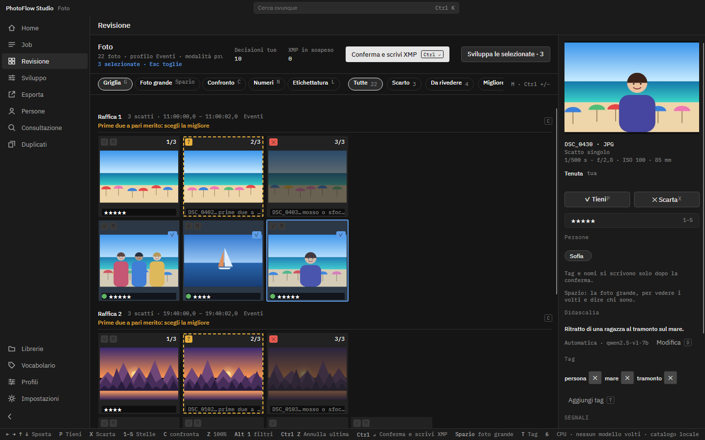

**Ctrl+clic** e **Ctrl A** selezionano più foto: P, X, stelle ed **etichette colore** (6 rosso, 7 giallo,
8 verde, 9 blu, come in Lightroom) valgono per tutte con un solo Ctrl Z, e il pulsante diventa «Sviluppa le
selezionate». I filtri in alto contano anche le etichette.

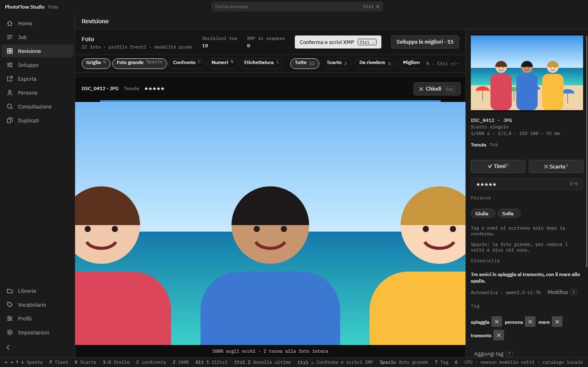

Nella foto grande **Z** mostra al 100% gli occhi del volto più grande (o il punto di fuoco); le foto
successive sono già pronte mentre si guarda quella aperta. Nel confronto **K** fissa la candidata e **→**
le porta accanto lo scatto successivo della raffica. **F11** mette tutto a schermo intero.

### 4. Sviluppo — luce, colore e rumore, foto per foto

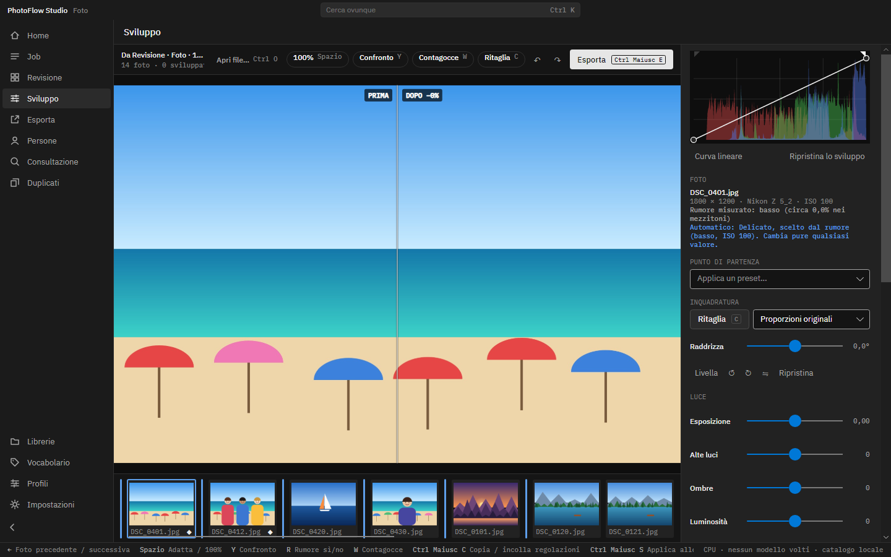

Tre fasce: strumenti in alto, la foto al centro con il **prima/dopo a tendina**, la striscia della
selezione in basso; a destra il pannello, dall'alto verso il basso nell'ordine in cui si ragiona:

| Blocco | Cosa contiene |
|---|---|
| Istogramma e curva | sempre visibile; la curva si modifica trascinando i punti |
| Foto | ISO, rumore misurato, metodo |
| Punto di partenza | preset (Delicato, Bilanciato, Forte…), copia/incolla |
| Inquadratura | ritaglio **C** con proporzioni (3:2, 4:5, 1:1…), raddrizza (anche «Livella» automatico), ruota, specchia |
| Luce | esposizione, alte luci, ombre, luminosità (automatica di serie) |
| Colore | bilanciamento del bianco (fotocamera, automatico, luce diurna, temperatura e tinta), contagocce **W**, saturazione |
| Toni | contrasto |
| Rumore | attivo di serie con un preset scelto dal rumore misurato, grana, colore, metodo classico o neurale |
| Avanzate | dettaglio, pixel caldi, demosaicizzazione |

La riduzione del rumore **non è un passaggio a parte**: è attiva di serie con un preset automatico
(«Automatico: Bilanciato, rumore medio, ISO 3200») e si spegne con **R**. Lo stato è sempre scritto:
«attiva · metodo · −54%», «in calcolo», «spenta».

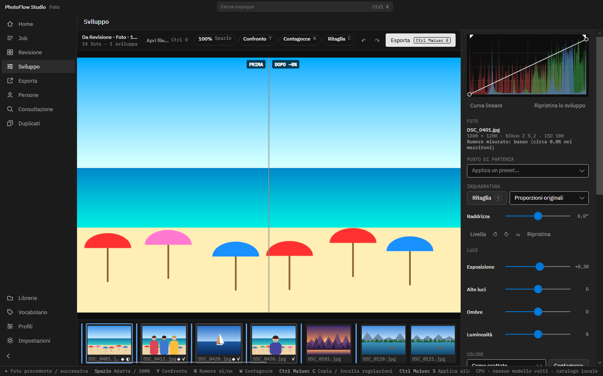

Le regolazioni si salvano da sole nel catalogo, con annulla/ripeti per foto (Ctrl Z / Ctrl Y). Per
estenderle ad altre foto si selezionano nella striscia (Ctrl o Maiusc + clic) e si preme **«Applica alle
selezionate (N)»** (Ctrl Maiusc S): copia **solo i campi cambiati**, si annulla con un clic. Niente
sincronizzazione automatica.

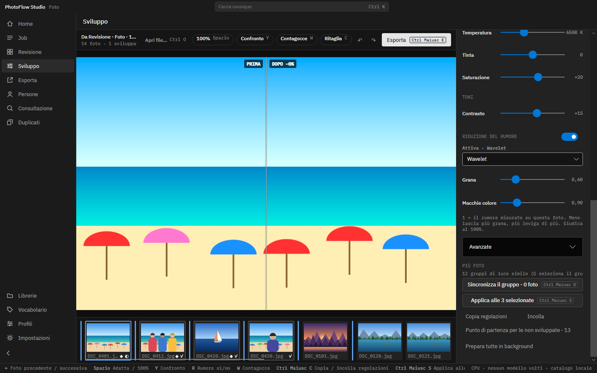

In fondo al pannello: **Toni**, **Riduzione del rumore** (interruttore, metodo, grana e macchie di colore,
dove 1 è il rumore misurato su questa foto), **Avanzate** chiuse, e il blocco **Più foto** con «Applica
alle 3 selezionate», copia e incolla.

**Y** cambia il confronto (tendina, solo dopo, solo prima, differenza: cosa ha tolto la riduzione del
rumore); **\\** tenuto mostra l'originale; **Spazio** passa da adatta a 100%, dove l'anteprima calcola
subito la zona visibile.

Il pannello di destra scorre con la rotella ovunque si trovi il puntatore, anche sopra i cursori, e la sua
barra di scorrimento resta sempre visibile: le regolazioni in fondo non restano nascoste.

**Foto non importate.** «Apri file…» (**Ctrl O**) o il trascinamento di file e cartelle da Esplora file
aprono nello Sviluppo foto che non sono nel catalogo: RAW, DNG, JPEG, PNG, TIFF. Diventano la selezione
di lavoro («Dal disco · cartella · N foto») con tutte le regolazioni, il rumore, il ritaglio e
l'esportazione; le impostazioni si salvano nella cartella dati di PhotoFlow Studio (mai accanto
all'originale) e ritornano quando lo stesso file si riapre. Il catalogo non cambia: per archiviarle e
cercarle resta l'importazione.

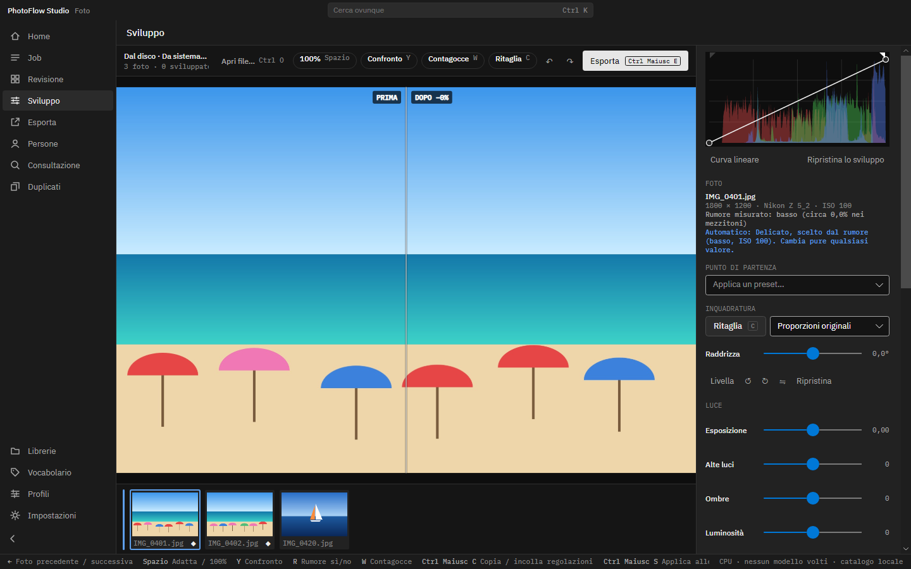

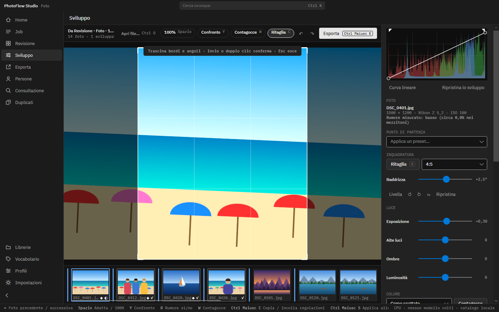

**C** apre il ritaglio sulla foto intera raddrizzata: si trascinano bordi e angoli con le proporzioni
scelte, Invio o doppio clic conferma. Il ritaglio vale per le anteprime e per tutte le consegne; nel DNG per
Lightroom rotazione e ritaglio diventano istruzioni standard.

**Con centinaia di foto.** La striscia è divisa in **gruppi di luce simile** (una barra azzurra dove ne
comincia uno): si sviluppa una foto per gruppo e **Ctrl Maiusc G** porta le stesse modifiche sul resto del
gruppo. «Punto di partenza per le non sviluppate» dà a tutte le altre il look della foto aperta. Le foto
vicine si **preparano da sole** in background (◆ nella striscia) e si aprono subito; «Prepara tutte» le
calcola tutte con il tempo che manca.

### 5. Esporta — ricetta e coda

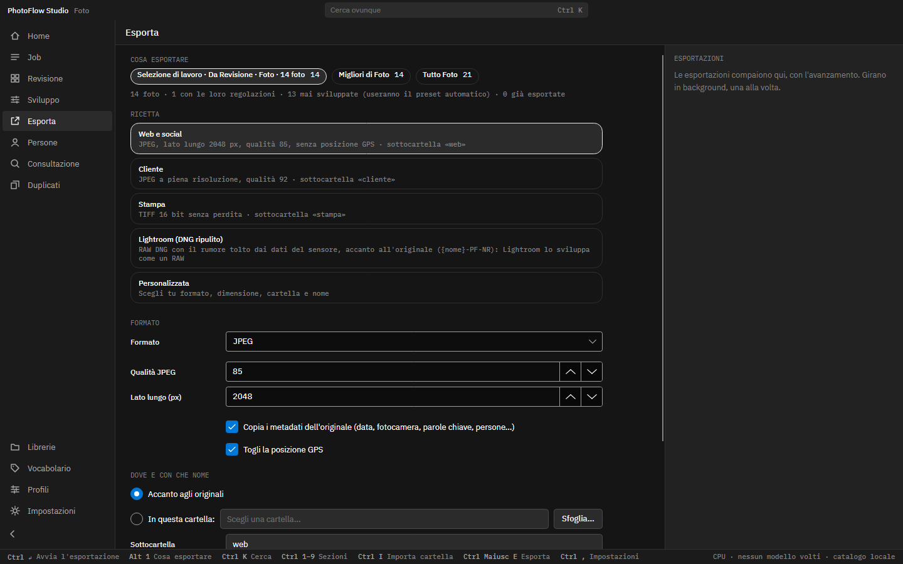

Una pagina, non una finestra: **cosa** esportare (la selezione di lavoro, le migliori dell'evento, tutto
l'evento), con quale **ricetta**, **dove**, con quale **nome** e cosa fare se il file esiste già (di serie
«altro nome»: mai sovrascrivere).

| Ricetta | Uscita |
|---|---|
| Web e social | JPEG, lato lungo 2048 px, qualità 85, senza GPS, sottocartella `web` |
| Cliente | JPEG a piena risoluzione, qualità 92, sottocartella `cliente` |
| Stampa | TIFF 16 bit, sottocartella `stampa` |
| Lightroom (DNG ripulito) | DNG accanto all'originale, `{nome}-PF-NR`, toni come istruzioni Camera Raw |
| Personalizzata | tutte le opzioni |

Il nome accetta i segnaposti `{nome}`, `{data}`, `{evento}`, `{stelle}`, `{seq}`. Le foto mai sviluppate
escono con lo sviluppo automatico (preset scelto dal rumore).

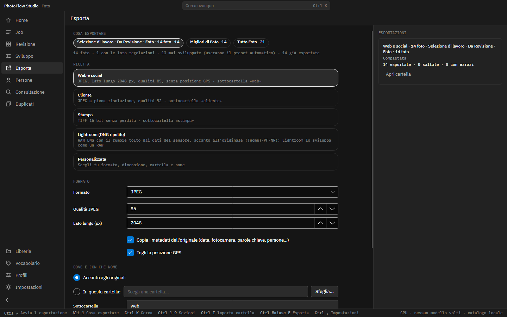

**Ctrl Invio** mette l'esportazione in coda e si può tornare a lavorare: la coda mostra l'avanzamento e il
tempo che manca, poi esportate, saltate ed errori, con **Apri cartella**. Ogni foto esce con le regolazioni
che aveva quando è entrata in coda, con autore, copyright, parole chiave, persone e didascalia scritti nel
file.

### 6. Archivio — persone, ricerca, duplicati

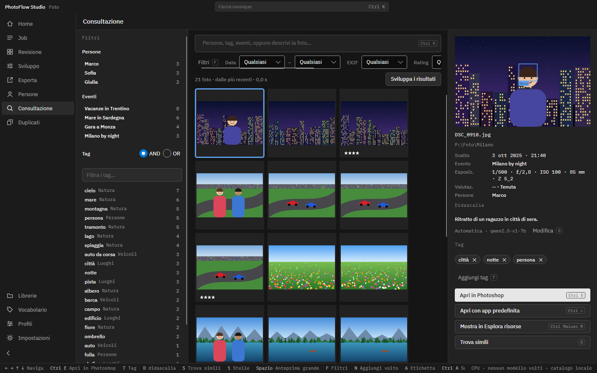

La **Consultazione** trova qualsiasi foto per persona, evento, tag, data, fotocamera, stelle o
descrivendola a parole; **«Sviluppa i risultati»**, accanto al numero di foto trovate, manda la ricerca
allo Sviluppo, chiudendo il cerchio
anche per le foto d'archivio. Anche qui **Ctrl+clic** e **Ctrl A** selezionano più foto per dare stelle,
etichette e un tag a tutte o mandarle allo Sviluppo o all'Esportazione; il filtro **Etichetta** ritrova le
selezioni («verde = album»). Nel pannello della foto compaiono le **versioni ritoccate** salvate da Photoshop
accanto all'originale, con Apri e Mostra. **Persone** raccoglie i volti riconosciuti da confermare e
nominare; **Duplicati** mette a confronto copie esatte e quasi uguali e sposta (mai cancella) quelle da
togliere.

## Dietro le quinte: lo sviluppo

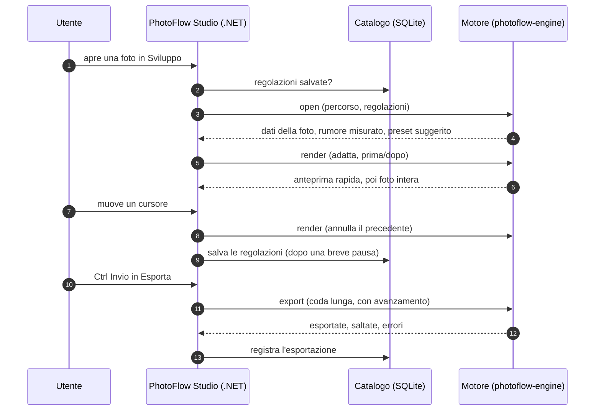

Il motore è il calcolo di Denoiser (sviluppo RAW con rawpy, riduzione del rumore classica e neurale con
ONNX Runtime/DirectML, esportazione JPEG/TIFF/PNG/DNG con i metadati via ExifTool), in un processo
separato con due code: le anteprime non aspettano mai un'esportazione.

## Scorciatoie principali

| Tasto | Dove | Azione |
|---|---|---|
| Ctrl 1–9 | ovunque | sezioni, nell'ordine della barra |
| Ctrl I | ovunque | import da scheda |
| Ctrl Maiusc E | ovunque | esporta la selezione (apre Esporta) |
| Ctrl E | ovunque | apri nell'editor esterno |
| Ctrl Maiusc R | Consultazione, Persone | mostra in Esplora risorse |
| P · X · 1–5 · C | Revisione | tieni · scarta · stelle · confronta |
| Spazio | Revisione, Consultazione / Sviluppo | foto grande / adatta ↔ 100% |
| ← → | Sviluppo | foto precedente / successiva |
| R · W · Y | Sviluppo | rumore sì/no · contagocce · tipo di confronto |
| C · Invio | Sviluppo | ritaglio · conferma |
| G · Ctrl Maiusc G | Sviluppo | seleziona il gruppo · sincronizza il gruppo |
| Ctrl+clic · Ctrl A | Revisione, Consultazione, Sviluppo | selezione multipla · seleziona tutte |
| 6 · 7 · 8 · 9 | Revisione, Consultazione | etichetta rossa · gialla · verde · blu |
| Z · K | Revisione | 100% sugli occhi (foto grande) · candidata (confronto) |
| F11 | ovunque | schermo intero |
| \ (tenuto) | Sviluppo | mostra l'originale |
| Ctrl Maiusc C / V / S | Sviluppo | copia · incolla · applica alle selezionate |
| Ctrl Z / Ctrl Y | Sviluppo | annulla / ripeti (per foto) |
| Ctrl Invio · Alt 1–3 | Esporta | avvia · cosa esportare |

La barra di stato in basso ricorda sempre i tasti della schermata aperta.

## Il contributo degli specialisti

| Specialista | Cosa ha deciso |
|---|---|
| Interfaccia visiva | pagina di Sviluppo a tre fasce, istogramma sempre in vista, un solo stile (token e componenti di PhotoFlow), stato del rumore in tre forme visibili |
| Esperienza d'uso | barra laterale nell'ordine del lavoro, selezione di lavoro condivisa con la sua origine, regolazioni nel catalogo |
| Psicologia cognitiva | una domanda per schermata, pannello a blocchi con divulgazione progressiva, annullare invece di confermare, giudicare e regolare separati |
| Captologia | il passo successivo proposto una volta e senza finestre, ricette di consegna, niente dark pattern né punteggi, IA che spiega i suoi perché |
| Progettazione dell'interazione | una sola tabella di scorciatoie coerente in tutto il programma, «applica alle selezionate» esplicito, esportazione in coda non modale |
| Workflow fotografico | culling prima dello sviluppo, DNG ripulito per Lightroom, sviluppo mai negli XMP dei RAW, nomi con `{evento}`, `{stelle}`, `{seq}` |
