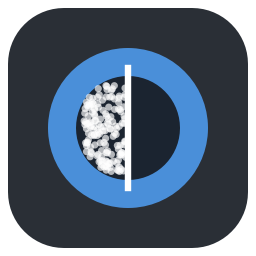

# Denoiser

**Riduzione del rumore per foto RAW, JPG, PNG e TIFF, interamente sul tuo computer.**

Nessun abbonamento, nessun caricamento nel cloud: la foto non lascia mai il PC.

## Cosa fa

- **Toglie il rumore dai RAW prima dello sviluppo**, direttamente sui dati del sensore: è il punto
  in cui il rumore è più facile da separare dal dettaglio. Funziona con tutte le fotocamere lette da
  [LibRaw](https://www.libraw.org) (NEF, CR2/CR3, ARW, RAF, ORF, RW2, DNG…) e, tramite Adobe DNG
  Converter, anche con i modelli più recenti.
- **Misura il rumore sulla foto stessa**: nessun profilo per fotocamera. Con «Grana» = 1 viene tolto
  esattamente il rumore misurato.
- **Separa grana e macchie di colore**, con cursori indipendenti.
- **Sette metodi**, tre classici e quattro reti neurali (DRUNet, SCUNet, Restormer e RawNIND) che girano
  in locale, sulla scheda video se disponibile.
- **Anteprima immediata al 100%** con tendina prima/dopo e vista del «rumore tolto» per controllare
  di non perdere dettaglio; con la foto rimpicciolita, risultato calcolato sulla **foto intera**.
- **Salva in TIFF, PNG, JPEG o DNG**, conservando metadati (EXIF, GPS, parole chiave…) e profilo colore.
  Il DNG ripulito si apre in Lightroom, darktable e simili come un RAW.
- **Sviluppa la foto**: curva dei toni sopra l'istogramma, bilanciamento del bianco (temperatura,
  tinta, contagocce), esposizione, contrasto, luminosità, alte luci, ombre e saturazione. Ogni foto
  ricorda le sue regolazioni, che si possono applicare a un'intera raffica.
- **Apre intere cartelle** in un carosello di miniature: scorri le foto, selezionane quante vuoi ed
  esportale tutte insieme, scegliendo metodo, cartella e formato.

## Schermate

| | |
|:---:|:---:|
|  **Pagina iniziale** con i file recenti |  **Tutta la foto**, originale a sinistra e risultato a destra |
|  **Rumore tolto** (×4): solo grana uniforme = dettaglio salvo |  **Reti neurali** in locale, con stato del modello e della GPU |
|  **Esportazione** con riepilogo e accesso al file |  **Carosello** della cartella, con più foto selezionate da esportare |

Altre schermate e la spiegazione di ogni comando sono nella **[guida all'uso](docs/guida.md)**.

## Installazione (Windows)

1. Apri la pagina **[Releases](https://github.com/foyer-labs/Image-Denoiser/releases)** e scarica
   `Denoiser-windows-<versione>.zip` dall'ultima versione.
2. Estrai lo zip dove preferisci (es. `C:\Programmi\Denoiser` o il Desktop).
3. Avvia `Denoiser\Denoiser.exe`. Non serve installare altro: Python, librerie ed ExifTool sono inclusi.

> Al primo avvio Windows SmartScreen può mostrare «App non riconosciuta», perché l'eseguibile non è
> firmato digitalmente: scegli *Ulteriori informazioni → Esegui comunque*.

Nella stessa cartella c'è `denoiser-cli.exe` per l'uso da [riga di comando](docs/riga-di-comando.md).
Le versioni intermedie si trovano anche in *Actions → Test e build Windows → artefatto Denoiser-windows*.

**Requisiti:** Windows 10 o 11 a 64 bit, 8 GB di RAM (16 consigliati per foto oltre i 40 MP).
Una scheda video (NVIDIA, AMD o Intel, tramite DirectML) accelera molto le reti neurali, ma non è necessaria.

## Uso in tre passi

1. **Apri** una foto (`Ctrl+O`) o una cartella (`Ctrl+Maiusc+O`), anche trascinandola nella finestra. Si apre al 100%, dove il rumore si vede davvero.
2. **Scegli il metodo e applica** (`Ctrl+Invio`); regola «Grana» e «Macchie di colore» se serve: 1 = rumore misurato. Tutto il resto ha già valori consigliati.
3. **Esporta** (`Ctrl+E`): nella finestra scegli cartella, formato (TIFF, PNG, JPEG o DNG) e nome. Per più foto: selezionale nel carosello ed **Esporta selezionate** (`Ctrl+B`).

Ogni pulsante mostra la propria scorciatoia, e `F1` apre la guida con l'elenco completo.

## Quale metodo scegliere

| Metodo | Quando usarlo | Velocità |
|---|---|---|
| **Wavelet** (predefinito) | Uso generale, ottimo sulle macchie di colore | ●●●●● |
| **Bilaterale** | Rumore leggero, quando serve velocità | ●●●●● |
| **Non-Local Means** | Trame fini (tessuti, foglie) | ●●●○○ |
| **DRUNet (IA)** | Massima qualità sui RAW ad ISO alti | ●●○○○ con GPU, ●○○○○ senza |
| **SCUNet (IA)** | JPG e foto da smartphone | ●●○○○ con GPU, ●○○○○ senza |
| **RawNIND (IA)** | RAW di reflex e mirrorless: più dettaglio, aspetto naturale | ●●●○○ con GPU, ●●○○○ senza |
| **Restormer (IA)** | Risultato molto pulito, anche su JPG | ●○○○○ con GPU, molto lento senza |

I modelli neurali non sono inclusi: l'app li scarica la prima volta dalle pubblicazioni ufficiali
(DRUNet 125 MB, SCUNet 69 MB, Restormer 100 MB, RawNIND 55 MB), li verifica e da quel momento funziona
offline.
Misure di qualità e dettagli tecnici: **[come funziona](docs/come-funziona.md)**.

## Documentazione

| Documento | Contenuto |
|---|---|
| [Guida all'uso](docs/guida.md) | Tutti i comandi dell'interfaccia, con schermate e scorciatoie |
| [Come funziona](docs/come-funziona.md) | Livelli di denoise, misura del rumore, algoritmi, reti neurali, qualità misurata, limiti |
| [Riga di comando](docs/riga-di-comando.md) | `denoiser-cli`: elaborazione in serie, preset, modelli |
| [Sviluppo](docs/sviluppo.md) | Ambiente, test, struttura del codice, build e pubblicazione di una versione |
| [Novità](CHANGELOG.md) | Cronologia delle versioni |
| [Licenze di terze parti](THIRD-PARTY-NOTICES.md) | Librerie, modelli e strumenti inclusi o scaricati |

## Autori

Ideato e curato da [foyer-labs](https://github.com/foyer-labs), sviluppato con
[Claude Code](https://claude.com/claude-code).

## Licenza

Il codice è distribuito con **[licenza MIT](LICENSE)**: puoi usarlo, modificarlo, farne un fork e
ridistribuirlo liberamente, anche in altri progetti, mantenendo l'avviso di copyright.

I componenti di terze parti inclusi nel pacchetto per Windows, e i modelli neurali scaricati al primo
uso, restano soggetti alle rispettive licenze: vedi [THIRD-PARTY-NOTICES.md](THIRD-PARTY-NOTICES.md).
Segnalazioni e proposte sono benvenute nella sezione
[Issues](https://github.com/foyer-labs/Image-Denoiser/issues).
