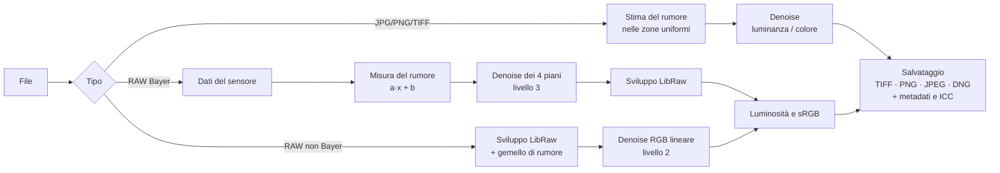

# Come funziona

[← Torna al README](../README.md)

Questa pagina spiega le scelte tecniche: dove viene tolto il rumore, come viene misurato, cosa fanno
gli algoritmi e quanto rendono.

- [Il percorso di una foto](#il-percorso-di-una-foto)
- [RAW: denoise sui dati del sensore (livello 3)](#raw-denoise-sui-dati-del-sensore-livello-3)
- [RAW non Bayer e livello 2: il «gemello di rumore»](#raw-non-bayer-e-livello-2-il-gemello-di-rumore)
- [JPG, PNG e TIFF](#jpg-png-e-tiff)
- [Algoritmi](#algoritmi)
- [Reti neurali in locale](#reti-neurali-in-locale)
- [Qualità misurata](#qualità-misurata)
- [Anteprima ed esportazione](#anteprima-ed-esportazione)
- [File di uscita](#file-di-uscita)
- [Limiti noti](#limiti-noti)

## Il percorso di una foto

## RAW: denoise sui dati del sensore (livello 3)

Per i sensori Bayer (quasi tutte le fotocamere tranne le Fujifilm X-Trans) il rumore viene tolto
**prima della demosaicizzazione**. È il punto più favorevole: ogni fotosito ha il proprio rumore,
indipendente dagli altri, e il suo comportamento è noto dalla fisica del sensore.

1. **Misura del rumore** sulla foto stessa, con il modello Poisson-gaussiano
   `varianza = a·segnale + b`: *a* dipende dalla luce raccolta (rumore fotonico), *b* dall'elettronica
   (rumore di lettura). Si osservano le zone più uniformi a vari livelli di luminosità, con fasce più
   fitte al buio. Le trame dell'immagine possono solo gonfiare la varianza, quindi si adatta la retta
   all'inviluppo inferiore. Le zone vicine alla saturazione sono escluse, e un solo modello vale per i
   tre colori (stesso guadagno). Nessun profilo per fotocamera: funziona anche con i modelli nuovi.
2. **Trasformata di Anscombe generalizzata**: rende il rumore uniforme (deviazione 1) a ogni
   luminosità, che è l'ipotesi su cui si basano gli algoritmi di denoise. Il ritorno usa l'inversa
   esatta non distorta di Mäkitalo e Foi, che non scurisce le ombre.
3. **Pesi del bilanciamento del bianco**: prima del bilanciamento un grigio ha meno segnale in R e B
   che in G. I piani vengono pesati (√moltiplicatore) perché un grigio resti neutro: altrimenti i
   suoi bordi finirebbero nelle componenti di colore e il denoise del colore creerebbe aloni.
4. **Separazione in luminanza e colore**: i quattro piani (R, G1, G2, B) vengono trasformati in
   modo ortonormale in luminanza, due componenti di colore e lo squilibrio dei verdi, ciascuna
   ripulita con la propria forza e il proprio livello di rumore.
5. **Pixel caldi**: un fotosito molto più chiaro dei vicini è un pixel caldo solo se i fotositi
   accanto degli altri colori non sono anch'essi più chiari (altrimenti è una stella o una luce).
6. I dati ripuliti vengono riscritti nel RAW e **sviluppati da LibRaw**.

Con **forza 1** si toglie esattamente il rumore misurato.

## RAW non Bayer e livello 2: il «gemello di rumore»

Per gli altri sensori, o scegliendo *Dopo lo sviluppo*, il denoise avviene sull'immagine RGB
lineare sviluppata. Dopo la demosaicizzazione il rumore è correlato tra pixel e canali, e misurarlo
sull'immagine lo sottovaluta di 3–6 volte. Per questo si usa un **gemello di rumore**: un rumore
sintetico con le stesse caratteristiche di quello del sensore viene aggiunto ai dati grezzi e fatto
passare per lo stesso sviluppo. La differenza tra i due sviluppi mostra esattamente come appare il
rumore dopo la demosaicizzazione. Con le demosaicizzazioni adattive (AHD, PPG…) il gemello sovrastima
la varianza del 10–25%, e un fattore calibrato per ciascun algoritmo lo corregge.

Anche qui la trasformata è pesata per canale, così un grigio resta neutro.

Per i RAW Bayer i pixel caldi vengono comunque tolti sui dati del sensore, anche al livello 2:
dopo lo sviluppo sono macchioline colorate difficili da distinguere dalle stelle.

## JPG, PNG e TIFF

Il rumore viene stimato nelle zone uniformi (filtro di Immerkær, stima robusta) e tolto
separatamente su luminanza e colore (trasformazione opponente ortonormale). Nei JPG il rumore è già
stato elaborato e compresso dalla fotocamera: spesso serve una forza un po' più alta di 1.

Il profilo colore incorporato viene conservato nel file di uscita, l'orientamento EXIF viene
applicato, e i file CMYK vengono convertiti in RGB.

## Algoritmi

| Algoritmo | Come funziona | Punti di forza |
|---|---|---|
| **Wavelet** | Scompone l'immagine in dettagli di varie grandezze e attenua quelli più deboli del rumore (BayesShrink, *cycle spinning* contro i blocchi) | Veloce, ottimo sul colore |
| **Non-Local Means** | Media le zone simili sparse nella foto (OpenCV, 16 bit) | Trame e bordi |
| **Bilaterale** | Media i vicini simili per posizione e valore | Molto veloce |
| **DRUNet** | Rete neurale U-Net che riceve la mappa del rumore misurato | Qualità massima sui RAW |
| **SCUNet** | Rete con attenzione Swin, addestrata su rumore reale; stima il rumore da sola | JPG e smartphone |
| **Restormer** | Rete *transformer* con attenzione tra i canali, addestrata su rumore reale (SIDD); stima il rumore da sola | Risultato molto pulito; lenta |
| **RawNIND** | Rete U-Net addestrata su coppie vere di RAW rumorosi e puliti di reflex e mirrorless; lavora sui dati del sensore | Dettaglio e aspetto naturali sui RAW; veloce |

`denoiser-cli algoritmi` elenca tutti i parametri di ciascun metodo.

## Reti neurali in locale

- I modelli **non sono inclusi** nel programma: alla prima scelta vengono scaricati dalle release
  ufficiali, verificati con un'impronta SHA-256 e convertiti in ONNX sul computer:
  [KAIR](https://github.com/cszn/KAIR) per DRUNet (125 MB, MIT) e SCUNet (69 MB, Apache 2.0),
  [Restormer](https://github.com/swz30/Restormer) (100 MB, MIT). RawNIND (55 MB) arriva già in ONNX
  dal pacchetto pubblicato da [darktable](https://github.com/darktable-org/darktable-ai): l'app ne
  estrae i due modelli, «bayer» e «lineare».
- I file `.pth` vengono letti **senza PyTorch e senza eseguire codice** contenuto nel file
  (lettore pickle ristretto); i grafi ONNX sono ricostruiti a mano e confrontati nei test con
  implementazioni di riferimento.
- L'esecuzione usa ONNX Runtime con **DirectML** (qualsiasi scheda video su Windows) e ripiega da
  sola sul processore.
- Le foto vengono elaborate a **tasselli** sovrapposti e fusi con pesi sfumati. Per DRUNet i
  tasselli sono adattati alla dimensione della foto, per non ricalcolare pixel inutili.
- Le reti lavorano su un'immagine a colori: al livello 3 i quattro piani diventano un'immagine RGB a
  metà risoluzione (verde = media dei due verdi), e la differenza tra i verdi viene ripulita a parte.
- SCUNet non sa quanto rumore c'è: la sua miscela viene limitata in modo che non tolga più del
  rumore misurato, per evitare che cambi toni e colori. Restormer funziona allo stesso modo; il suo
  grafo è costruito per tasselli di misura fissa (256 o 512 px), perché l'attenzione è calcolata
  sull'intero tassello.
- **RawNIND** non passa dalla trasformata stabilizzante: al livello 3 riceve i quattro piani del
  sensore (nero = 0, bianco = 1, senza bilanciamento del bianco) e restituisce l'immagine a piena
  risoluzione, che viene ricampionata sui fotositi (ogni fotosito riprende il suo colore). Lo sviluppo
  resta quello dell'app: demosaicizzazione scelta, bilanciamento del bianco e DNG dei dati del
  sensore funzionano come con gli altri metodi. Al livello 2, per i sensori non Bayer e per i JPG,
  si usa il modello «lineare» su RGB lineare Rec. 2020. La rete restituisce i valori a una scala
  propria, riportata a quella dell'ingresso tassello per tassello. Se il sensore non inizia con un
  fotosito rosso, si parte dal primo rosso: la prima riga o colonna della foto resta com'è.
- I modelli si trovano in `%LOCALAPPDATA%\Denoiser\modelli` (oppure nella cartella indicata da
  `DENOISER_MODELS_DIR`).

## Qualità misurata

Test con immagini sintetiche e rumore noto (PSNR, più alto è meglio; con le impostazioni predefinite,
forza 1). RAW: DNG Bayer sintetico con bilanciamento del bianco tipico (R ×2, B ×1,43) e rumore da
ISO alto. JPG: rumore gaussiano e compressione JPEG (qualità 92).

| | Rumoroso | Wavelet | NLM | Bilaterale | DRUNet | SCUNet |
|---|---|---|---|---|---|---|
| RAW, livello 3 | 29,7 dB | 32,1 | 31,7 | 32,6 | **33,4** | 31,9 |
| RAW, livello 2 | 29,7 dB | 31,4 | 33,0 | 32,4 | 33,2 | **34,5** |
| JPG | 28,4 dB | 31,8 | 31,8 | 31,5 | **34,4** | 33,6 |

Altre verifiche:

- **Bordi neutri** (forza sul colore 2): errore di colore sul bordo 0,009 al livello 3 e 0,05 al
  livello 2, contro 0,33 e 0,23 senza i pesi per canale.
- **Stelle e pixel caldi** (soglia predefinita): pixel caldi rimossi al 96%, flusso delle stelle
  conservato al 93–101%.
- **Anteprima di una zona ed esportazione**: differenza massima 0,3 volte il rumore con la wavelet,
  0,08 con DRUNet.
- Con rumore molto basso il guadagno si riduce: a ISO bassi SCUNet può rendere meno dell'originale,
  mentre wavelet e DRUNet restano sopra.

Confronto delle reti neurali con il rumore misurato su una Nikon D5100 (DNG Bayer sintetici, media su
cinque immagini; PSNR in dB):

| | Rumoroso | DRUNet (liv. 3) | Restormer (liv. 2) | Restormer (liv. 3) | RawNIND (liv. 3) | RawNIND (liv. 2) |
|---|---|---|---|---|---|---|
| ISO 3200 | 27,1 | **31,3** | 30,0 | 28,2 | 26,9 | 26,7 |
| ISO 6400 | 23,8 | **29,3** | 28,2 | 26,2 | 26,2 | 25,8 |

RawNIND qui ammorbidisce: le immagini di prova sono piccole e con dettaglio fittissimo a livello di
pixel, diverso da quello dei RAW su cui è addestrata. Sui RAW veri (per esempio un NEF a ISO 3200) è
invece il metodo che conserva più dettaglio e l'aspetto più naturale: per questo metodo conta il
giudizio a occhio più del numero.

Sono misure su immagini sintetiche, utili per confrontare i metodi e verificare le correzioni;
le foto reali vanno sempre giudicate a occhio, al 100%.

## Anteprima ed esportazione

L'anteprima elabora solo la zona visibile, con un margine. Perché coincida con la foto esportata:

- l'origine della zona è allineata a 64 pixel (128 sul sensore), così scomposizione wavelet e
  tasselli cadono negli stessi punti della foto intera;
- le scelte automatiche (es. livelli wavelet) sono calcolate sulle dimensioni della foto intera;
- la luminosità viene ricalcolata senza rifare il denoise.

La vista ridotta usa una piramide a media d'area, così il rumore appare com'è e non compare moiré.
Lo zoom è espresso in pixel fisici dello schermo, anche con la scala di Windows al 125–200%.

## File di uscita

- **TIFF** (8/16 bit, compressione senza perdita), **PNG** (8/16 bit), **JPEG**.
- **DNG** (solo da RAW):
  - al livello 3 contiene i **dati del sensore ripuliti** (CFA): il programma di fotoritocco esegue la
    propria demosaicizzazione, e restano liberi bilanciamento del bianco e profili colore;
  - al livello 2 (o con sensori non Bayer) è un **DNG lineare**, con il bilanciamento del bianco già
    applicato.
  - Matrici colore ed esposizione di base del DNG d'origine vengono conservate.
- **Metadati**: copiati con [ExifTool](https://exiftool.org), incluso nel pacchetto per Windows
  (senza ExifTool vengono copiati solo quelli essenziali dei JPG). Orientamento e anteprime vengono
  esclusi, perché l'immagine è già ruotata e ricalcolata.
- **Profilo colore**: quello dell'originale, oppure sRGB per le uscite da RAW.
- **Impostazioni usate**: registrate nella descrizione del file.
- **Scrittura atomica**: file temporaneo `.parziale-…` rinominato solo alla fine.

## Limiti noti

- Il DNG lineare (livello 2) ha il bilanciamento del bianco già applicato.
- Nel DNG ripulito non vengono copiate le correzioni ottiche registrate come *OpcodeList*
  (tipiche degli smartphone).
- Al livello 3 l'anteprima sviluppa ogni volta l'intero sensore con LibRaw (circa 2 s su 24 MP).
- Le reti neurali sono addestrate su immagini sRGB: sui dati del sensore funzionano bene nei test,
  ma vanno verificate sulle foto reali.
- In immagini piccole con molte alte luci bruciate la stima del rumore può risultare alta.
