# Guida all'uso

[← Torna al README](../README.md)

- [La finestra](#la-finestra)
- [Aprire una foto](#aprire-una-foto)
- [Guardare il risultato](#guardare-il-risultato)
- [Regolare la riduzione del rumore](#regolare-la-riduzione-del-rumore)
- [Reti neurali (IA)](#reti-neurali-ia)
- [Sviluppare la foto](#sviluppare-la-foto)
- [Salvare](#salvare)
- [Esportare più foto](#esportare-più-foto)
- [Preset](#preset)
- [Scorciatoie da tastiera](#scorciatoie-da-tastiera)
- [Domande frequenti](#domande-frequenti)

## La finestra

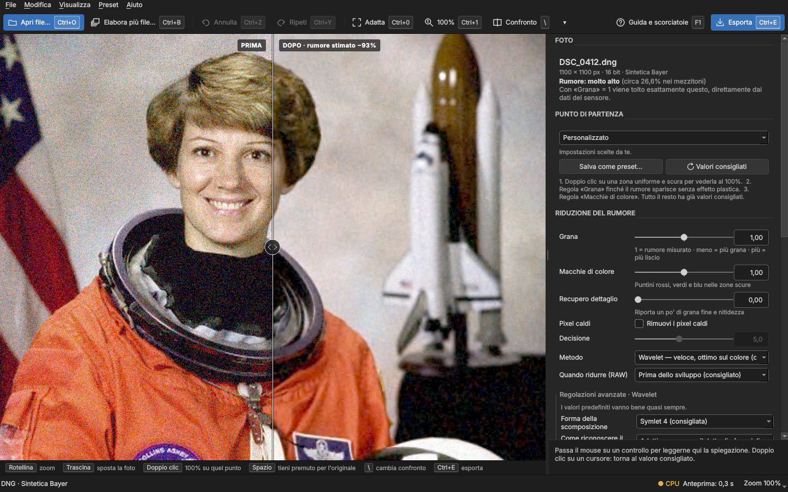

- **In alto**: i menu e la barra dei comandi principali. Ogni pulsante mostra la propria scorciatoia
  (es. *Apri file…* `Ctrl+O`). I comandi non disponibili in quel momento sono grigi.
- **Al centro**: la foto. Appena aperta è mostrata così com'è (*ORIGINALE*); dopo **Applica**, a
  sinistra della linea c'è l'originale (**PRIMA**), a destra il risultato (**DOPO**). L'etichetta in
  alto indica quanta parte del rumore stimato è stata tolta.
- **Sotto la foto**, se hai aperto una cartella: il [carosello](#aprire-una-cartella) con le miniature.
- **Sotto la foto**: una striscia ricorda i comandi della vista. Si nasconde da
  *Visualizza → Mostra i tasti sotto la foto*.
- **A destra**: il pannello delle impostazioni, dall'alto verso il basso nell'ordine in cui servono.
  Passando il mouse su un controllo, la sua spiegazione compare nel riquadro in fondo al pannello.
- **In basso**: informazioni sul file, dispositivo di calcolo (● GPU o ● CPU), tempo dell'ultima
  anteprima, livello di zoom e, durante le operazioni lunghe, avanzamento con il pulsante *Interrompi*.

## Aprire una foto

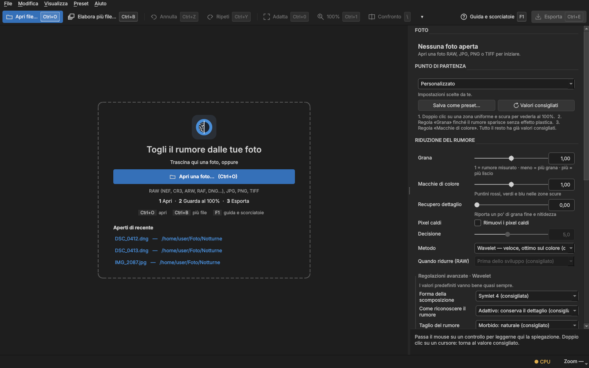

- **Apri file…** (`Ctrl+O`), oppure **trascina** una foto nella finestra.
- Dalla pagina iniziale o da *File → Apri recenti* si riaprono le ultime foto.
- **Apri cartella…** (`Ctrl+Maiusc+O`), oppure trascina una cartella o più foto: vedi
  [Aprire una cartella](#aprire-una-cartella).
- Formati: RAW di quasi tutte le fotocamere (NEF, CR2, CR3, ARW, RAF, ORF, RW2, PEF, DNG…), JPG, PNG, TIFF.

La foto si apre **senza riduzione del rumore**: scegli il **metodo** (ed eventualmente le regolazioni)
nel pannello, poi premi **Applica la riduzione del rumore** (`Ctrl+Invio`), oppure fai clic
sull'avviso in basso nella foto. Da quel momento il risultato si aggiorna da solo a ogni modifica.
Aprendo un'altra foto si riparte dall'originale, con le stesse regolazioni pronte da applicare.

Il pannello **Foto** riassume il file aperto: dimensioni, fotocamera, ISO e un giudizio sul rumore
misurato (basso, medio, alto, molto alto).

Se una fotocamera è troppo recente per LibRaw (o il file è un NEF «alta efficienza»), con
[Adobe DNG Converter](https://helpx.adobe.com/camera-raw/using/adobe-dng-converter.html) installato
(gratuito) l'app converte il file in DNG e lo apre senza altri passaggi.

### Aprire una cartella

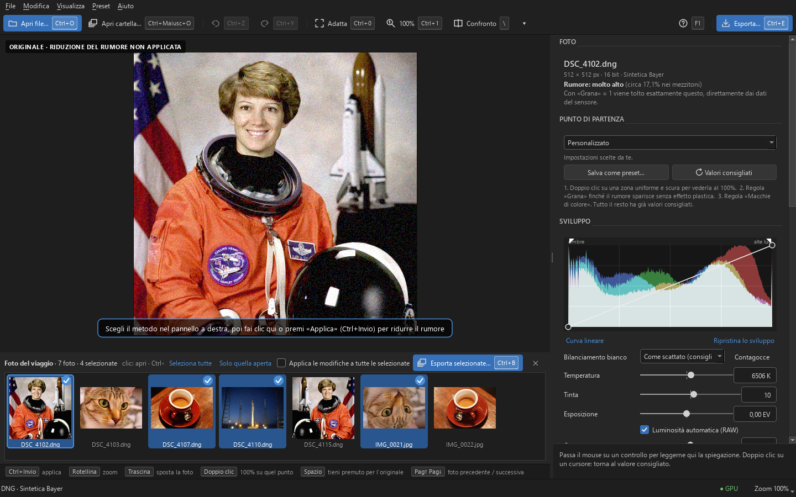

Con **Apri cartella…** le foto della cartella (non delle sottocartelle) compaiono nel **carosello**
sotto la foto, in ordine di nome, e si apre la prima. Le miniature dei RAW sono le anteprime
incorporate dalla fotocamera, quindi arrivano subito anche con centinaia di file.

| Azione | Come |
|---|---|
| Aprire una foto | Clic sulla miniatura |
| Foto precedente / successiva | `Pag↑` / `Pag↓`, oppure le frecce con il carosello attivo |
| Aggiungere o togliere una foto dalla selezione | `Ctrl+clic` |
| Selezionare un intervallo | `Maiusc+clic` |
| Selezionare tutte | *Seleziona tutte*, oppure `Ctrl+A` con il carosello attivo |
| Tenere selezionata solo la foto aperta | *Solo quella aperta* |
| Chiudere il carosello | ✕ a destra |

La foto aperta ha un bordo blu; quelle selezionate hanno lo sfondo blu e una spunta. Le foto
selezionate si esportano insieme con [Esporta selezionate](#esportare-più-foto).

## Guardare il risultato

La foto si apre **al 100%** (un pixel della foto = un pixel dello schermo, anche con la scala di Windows
al 125–200%), al centro: è il modo giusto per giudicare il rumore.

| Azione | Come |
|---|---|
| Spostare la foto | Trascina con il mouse, oppure frecce (con `Maiusc` passi più lunghi) |
| Zoom | Rotellina, `Ctrl +` / `Ctrl −`, oppure il menu dello zoom in basso a destra |
| Tutta la foto / 100% / 200% | `Ctrl+0` / `Ctrl+1` / `Ctrl+2` |
| Vedere al 100% un punto preciso | Doppio clic sul punto |
| Spostare la linea prima/dopo | Trascina la maniglia rotonda (doppio clic: torna al centro) |
| Vedere solo l'originale | Tieni premuto `Spazio` |
| Cambiare tipo di confronto | `\` oppure il pulsante *Confronto* (▾ per scegliere) |

Tipi di confronto: **tendina** (prima | dopo), **solo dopo**, **solo prima** e **rumore tolto**.

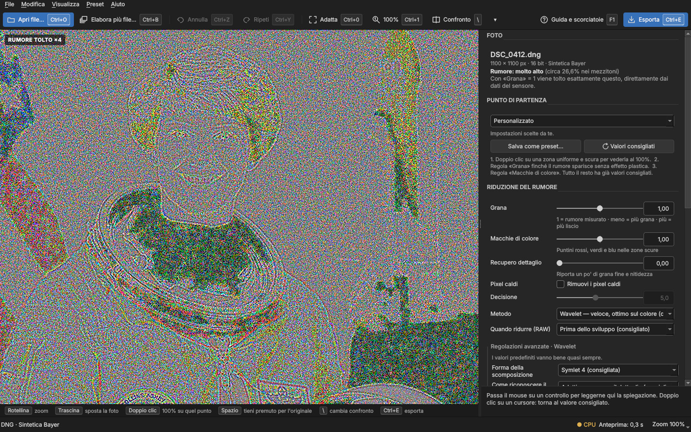

La vista **rumore tolto** mostra, amplificata quattro volte, la differenza tra originale e risultato.
Se vedi solo una grana uniforme il dettaglio è salvo; se compaiono i contorni degli oggetti la
riduzione è troppo forte: abbassa «Grana» o alza «Recupero dettaglio».

Il risultato si vede a **qualsiasi ingrandimento**. Da vicino (100%, 200%) viene calcolata solo la zona
visibile, in pochi istanti. Con la foto rimpicciolita (*Adatta*, 50%, 25%…) viene elaborata **la foto
intera**, come nel file esportato: un avviso al centro mostra percentuale e tempo rimanente. Così puoi
giudicare l'effetto sull'immagine nel suo insieme, utile soprattutto con i sensori da molti megapixel.
Finito il calcolo, ingrandimenti e spostamenti non richiedono altre attese finché non cambi
un'impostazione. Se durante il calcolo della foto intera ingrandisci un dettaglio, l'app passa alla
sola zona visibile, salvo che il calcolo sia già oltre la metà.

Mentre l'anteprima si aggiorna compare una sottile barra blu in alto. Se hai cambiato un'impostazione
e il calcolo non è ancora finito, il lato «dopo» è velato con l'etichetta *DA AGGIORNARE*.

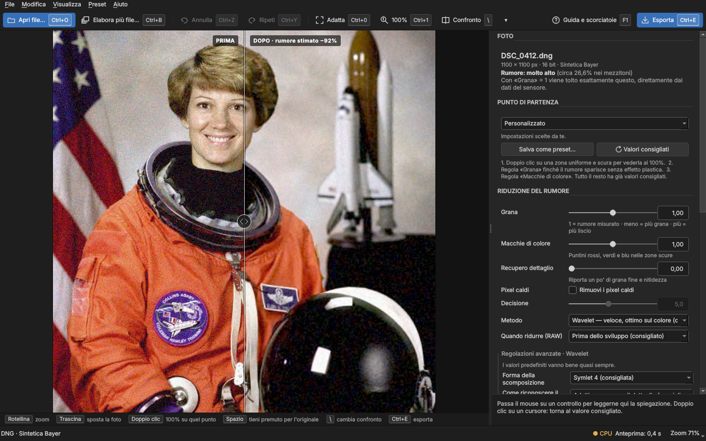

## Regolare la riduzione del rumore

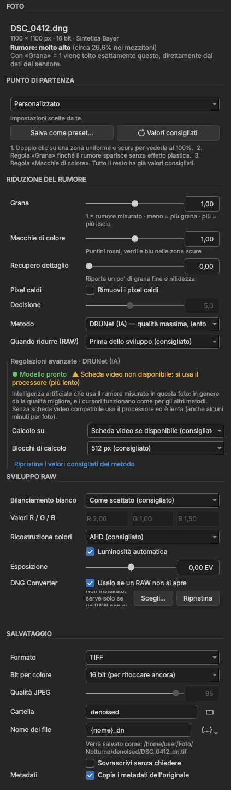

**Riduzione del rumore**

- **Grana**: rumore di luminosità. **1 = il rumore misurato** (la tacca a metà del cursore);
  meno lascia più grana naturale, più leviga di più.
- **Macchie di colore**: i puntini rossi, verdi e blu tipici delle ombre ad ISO alti. Di solito si
  può tenere un po' più alto della grana.
- **Recupero dettaglio**: riporta una parte di grana fine e nitidezza se il risultato sembra «di plastica».
- **Pixel caldi**: toglie i punti isolati troppo luminosi (lunghe esposizioni, sensore caldo).
  *Decisione* stabilisce quanto deve essere evidente un punto per essere tolto; stelle e luci
  puntiformi vengono riconosciute e conservate.
- **Metodo**: vedi [quale metodo scegliere](../README.md#quale-metodo-scegliere).
- **Quando ridurre (RAW)**: *Prima dello sviluppo* (consigliato) lavora sui dati del sensore;
  *Dopo lo sviluppo* sull'immagine già a colori, ed è utile solo per confronto.
- **Regolazioni avanzate**: parametri propri del metodo. I valori consigliati sono indicati
  tra parentesi; il link *Ripristina* li reimposta.

Doppio clic su un cursore: torna al valore consigliato. *Modifica → Annulla* (`Ctrl+Z`) e
*Ripeti* (`Ctrl+Y`) valgono per tutte le regolazioni.

 

## Reti neurali (IA)

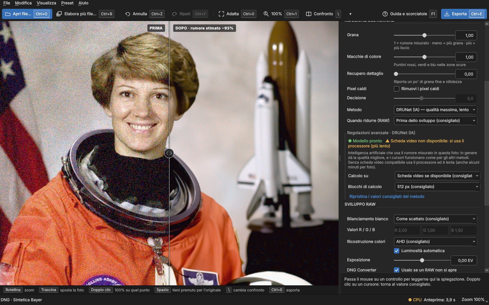

DRUNet, SCUNet, Restormer e RawNIND sono reti neurali che girano interamente sul tuo computer.

- La prima volta che le scegli, il pannello (o un avviso cliccabile nell'anteprima) propone di
  **scaricare il modello** dalla pubblicazione ufficiale. Il file viene verificato con un'impronta
  digitale e da quel momento tutto funziona **offline**.
- Lo stato è sempre visibile: *Modello pronto*, *Da scaricare* o avanzamento del download,
  e se viene usata la **scheda video** o il processore.
- Con una scheda video l'elaborazione richiede pochi secondi; con il solo processore anche
  alcuni minuti per foto. L'esportazione si può interrompere con `Esc`.
- **DRUNet** usa il rumore misurato: i cursori funzionano come per gli altri metodi.
  **SCUNet**, **Restormer** e **RawNIND** stimano il rumore da sole: lì «Grana» e «Macchie di
  colore» decidono quanto del loro risultato usare (1 = tutto).
- Quale scegliere: **DRUNet** è il più pulito e la scelta predefinita per i RAW. **RawNIND**, addestrata
  su RAW veri di reflex e mirrorless, conserva più dettaglio e un aspetto più naturale, lasciando un
  filo di grana nelle ombre; è veloce anche senza scheda video. **Restormer** dà un risultato molto
  pulito ma tende ad ammorbidire i dettagli finissimi ed è lenta: senza scheda video può richiedere
  molti minuti per foto.
- Con i RAW Bayer lascia *Quando ridurre* su «Prima dello sviluppo» con qualsiasi metodo: dopo lo
  sviluppo il rumore è «a macchie» (correlato tra pixel vicini) e DRUNet, in particolare, ne toglie
  poco. «Dopo lo sviluppo» serve per i sensori non Bayer (per esempio Fujifilm X-Trans), dove è
  l'unica possibilità. Ogni preset predefinito riporta questa impostazione su «Prima dello sviluppo». **SCUNet** resta indicata per JPG e smartphone.

## Sviluppare la foto

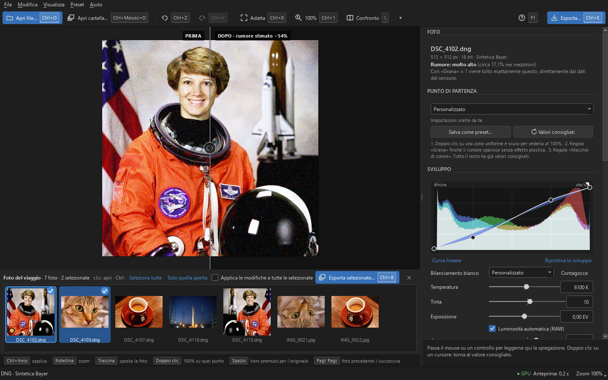

Il pannello **Sviluppo** regola colori e toni di RAW, JPG, PNG e TIFF. Le regolazioni si vedono
subito sulla foto, anche prima di applicare la riduzione del rumore.

- **Curva e istogramma**: l'istogramma mostra quanti pixel ci sono per ogni livello, dalle ombre
  (a sinistra) alle alte luci (a destra), in rosso, verde e blu, e si aggiorna a ogni regolazione.
  Sopra c'è la **curva dei toni**: clic per aggiungere un punto, trascina per spostarlo, doppio clic
  (o trascinarlo fuori dal riquadro) per toglierlo. Alzare la curva schiarisce quei toni, abbassarla
  li scurisce; i punti agli estremi alzano il nero o abbassano il bianco. I triangoli in alto si
  accendono quando ombre o alte luci sono tagliate. *Curva lineare* toglie tutti i punti.
- **Bilanciamento del bianco**: *come scattato* (consigliato), *automatico*, *luce diurna* (solo RAW)
  o **Temperatura** in kelvin e **Tinta**: muovendole si passa a *Personalizzato*. Con il
  **Contagocce** fai clic su qualcosa che dovrebbe essere grigio o bianco e il bilanciamento lo rende
  neutro (`Esc` per annullare). Nei JPG il punto di partenza è 6500 K, la luce del giorno.
- **Esposizione** in EV e, per i RAW, **Luminosità automatica**.
- **Contrasto**, **Luminosità** (i mezzitoni), **Alte luci**, **Ombre** e **Saturazione**, da −100 a
  +100 (0 = nessun effetto). *Alte luci* verso − recupera il dettaglio nelle zone quasi bruciate dei
  RAW; *Ombre* verso + schiarisce le zone scure (e rende più visibile il rumore che vi rimane).

*Ripristina lo sviluppo* riporta tutto ai valori di partenza. Toni e curva valgono allo stesso modo
su tutta la foto, quindi l'anteprima di una zona coincide sempre con il file esportato.

### Le regolazioni di ogni foto

Ogni foto ricorda le **sue** regolazioni: sviluppo e riduzione del rumore. Vengono salvate in un
piccolo file accanto alla foto, `DSC_0001.NEF.denoiser`, con un nome diverso da quelli di Lightroom e
darktable, che restano intatti. Se la cartella non è scrivibile (per esempio una scheda protetta), il
file va nella cartella dei dati dell'app. Nel carosello le foto regolate hanno un **punto giallo**.

Una foto mai regolata parte dai valori consigliati per lo sviluppo e dal metodo di riduzione del
rumore usato per ultimo. Annulla e ripeti valgono per la foto aperta.

**Per le raffiche**: seleziona le foto nel carosello e attiva **Applica le modifiche a tutte le
selezionate**. Da quel momento ogni regolazione che cambi sulla foto aperta (per esempio
l'esposizione) viene copiata anche sulle altre selezionate; tutto il resto resta quello di ciascuna.

### RAW

- **Ricostruzione colori**: algoritmo di demosaicizzazione (AHD consigliato). Cambiandola la foto
  viene risviluppata: se esporti subito, il salvataggio parte appena il nuovo sviluppo è pronto.
- **DNG Converter**: uso automatico di Adobe DNG Converter per i RAW che LibRaw non legge.

Il bilanciamento non richiede un nuovo sviluppo: è una correzione esatta nei colori della
fotocamera, applicata all'istante.

## Salvare

Il pannello a destra regola soltanto la foto: **come salvarla** si sceglie nella finestra che si
apre con **Esporta…** (`Ctrl+E`):

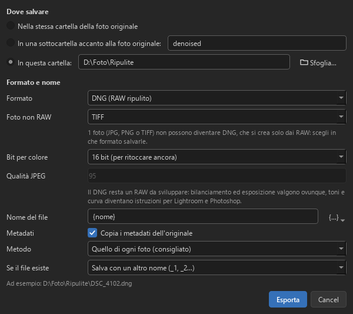

- **Dove salvare**: nella stessa cartella della foto, in una sottocartella accanto alla foto (es.
  `denoised`) oppure in una cartella a scelta (*Sfoglia…*).
- **Formato**: TIFF o PNG (8 o 16 bit), JPEG (qualità 1–100) oppure **DNG**, il formato RAW aperto
  che Lightroom, darktable, Capture One e simili sviluppano come l'originale. NEF, CR3, ARW e gli
  altri RAW delle fotocamere sono formati chiusi che nessun programma esterno può scrivere: per
  riesportare un RAW si usa il DNG, che si crea solo da foto RAW.
- **Nome del file**: di norma `{nome}`, il nome dell'originale con l'estensione del formato scelto
  (`DSC_0001.NEF` → `DSC_0001.tif`). Con il pulsante `{…}` si aggiungono `{metodo}`, `{iso}` o `{data}`.
- **Copia i metadati dell'originale**.

In fondo alla finestra compare il percorso esatto del file. La volta successiva la finestra
ripropone le stesse scelte: basta *Invio* per confermare. Se il file esiste già, l'app chiede se
sovrascriverlo o salvarlo con un altro nome.

Nel **DNG** il RAW resta da sviluppare: il bilanciamento del bianco diventa quello «come scattato»
del file, che rispettano tutti i programmi, e l'esposizione la sua esposizione di base. Contrasto,
alte luci, ombre, saturazione e curva diventano **impostazioni di Lightroom/Camera Raw**: aprendo il
DNG in Lightroom o Photoshop le ritrovi già applicate e modificabili. Altri programmi (darktable,
Capture One) ne leggono solo una parte, e il risultato di Lightroom è simile ma non identico a quello
di Denoiser, che usa formule proprie.

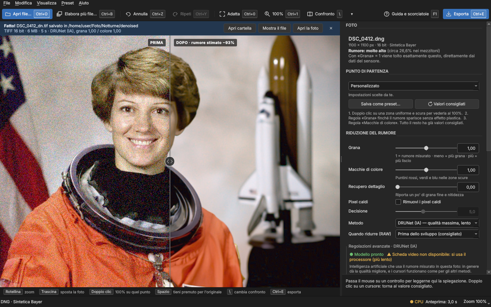

Al termine, un avviso riassume formato, dimensione, tempo e metodo, con i pulsanti *Apri cartella*,
*Mostra il file* e *Apri la foto*.

Vengono conservati metadati (data, fotocamera, obiettivo, GPS, parole chiave…) e profilo colore.
Le impostazioni usate vengono registrate nella descrizione del file. Il file viene scritto con un nome
temporaneo e rinominato solo alla fine: un'esportazione interrotta non lascia file a metà, e
l'originale non viene mai sovrascritto: se il file di uscita coinciderebbe con l'originale (stessa
cartella e stesso formato) al nome si aggiunge `_1`.

## Esportare più foto

1. [Apri la cartella](#aprire-una-cartella) e seleziona nel carosello le foto da esportare
   (`Ctrl+clic`, `Maiusc+clic` o *Seleziona tutte*).
2. **Esporta selezionate…** (`Ctrl+B`, pulsante nell'intestazione del carosello o menu *File*).
3. Nella stessa finestra di *Esporta* scegli dove salvare, **formato** e nome, più il **metodo** e cosa
   fare se il file esiste già (altro nome `_1`, `_2`…, sovrascrivere o saltare la foto).
4. **Esporta**. In basso vedi la foto in corso e il tempo stimato per tutte; **Interrompi** (`Esc`)
   si ferma senza lasciare file a metà.

Ogni foto viene esportata con le **sue** regolazioni (sviluppo e riduzione del rumore). Il campo
*Metodo* lascia di norma *Quello di ogni foto*; scegliendo un metodo, lo si usa per tutte con i suoi
valori consigliati. Con «Grana» e «Macchie di colore» a 1 ogni foto perde esattamente il rumore
misurato su di sé. Ogni file tiene il nome dell'originale; se
due foto darebbero lo stesso nome (es. `IMG_1.NEF` e `IMG_1.JPG` in TIFF) la seconda diventa `IMG_1_1`.

Se scegli il **DNG** e tra le foto ci sono JPG, PNG o TIFF, compare *Foto non RAW*: scegli in che
formato salvarle (TIFF, PNG o JPEG), mentre i RAW diventano DNG.

Al termine l'avviso in alto riassume le foto salvate, saltate e quelle non esportate con il motivo.

## Preset

Il menu **Punto di partenza** (e il menu *Preset*) offre impostazioni pronte:

| Preset | Per |
|---|---|
| Bilanciato | Uso generale (predefinito) |
| Delicato | Rumore leggero, massima naturalezza |
| Forte (ISO alti) | Foto notturne e ISO molto alti |
| Solo colore | Togliere solo le macchie di colore, lasciando la grana |
| Neurale RAW (DRUNet) | Massima qualità sui RAW |
| Neurale JPG (SCUNet) | JPG e foto da smartphone |
| Neurale RAW naturale (RawNIND) | RAW con più dettaglio e aspetto naturale |
| Neurale molto pulito (Restormer) | Risultato molto pulito (meglio con scheda video) |

Quando modifichi un preset il nome diventa «(modificato)». *Salva come preset…* salva le
impostazioni attuali scegliendo quali sezioni includere (riduzione del rumore, sviluppo, luminosità,
salvataggio). Da *Preset* puoi eliminare i tuoi preset o aprirne la cartella.

## Scorciatoie da tastiera

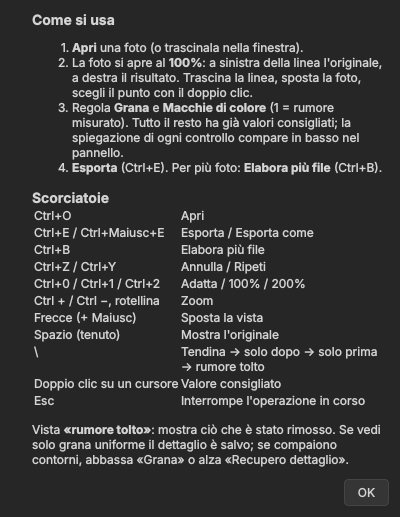

| Scorciatoia | Azione |
|---|---|
| `Ctrl+O` / `Ctrl+Maiusc+O` | Apri una foto / una cartella |
| `Ctrl+Invio` | Applica la riduzione del rumore |
| `Pag↑` / `Pag↓` | Foto precedente / successiva del carosello |
| `Ctrl+E` | Esporta (finestra con cartella, formato e nome) |
| `Ctrl+B` | Esporta le foto selezionate nel carosello |
| `Ctrl+Z` / `Ctrl+Y` | Annulla / Ripeti |
| `Ctrl+0` / `Ctrl+1` / `Ctrl+2` | Adatta / 100% / 200% |
| `Ctrl +` / `Ctrl −`, rotellina | Zoom |
| Frecce (+ `Maiusc`) | Sposta la vista |
| `Spazio` (tenuto) | Mostra l'originale |
| `\` | Tendina → solo dopo → solo prima → rumore tolto |
| Doppio clic su un cursore | Valore consigliato |
| `Esc` | Interrompe l'operazione in corso o il contagocce |
| `F1` | Guida e scorciatoie |

## Domande frequenti

**Il risultato è troppo liscio, «di plastica».**
Abbassa «Grana» (es. 0,7) o alza «Recupero dettaglio». Controlla con la vista *rumore tolto*.

**Restano macchie di colore nelle ombre.**
Alza «Macchie di colore» (1,3–2): il colore tollera una riduzione più forte della luminosità.

**Le reti neurali sono lente.**
Senza una scheda video compatibile girano sul processore. In basso a destra, ● GPU indica che la scheda
video è in uso. Wavelet e NLM danno ottimi risultati in pochi secondi.

**Un RAW non si apre.**
Installa [Adobe DNG Converter](https://helpx.adobe.com/camera-raw/using/adobe-dng-converter.html)
(gratuito): l'app lo userà da sola, convertendo il file al volo senza toccare l'originale (i DNG
convertiti restano in una cache, così la stessa foto si riapre subito).

I **NEF Nikon «alta efficienza»** (HE e HE\*, per esempio di Z 5II, Z 6III, Z 8, Z 9 e Z f) usano una
compressione brevettata (TicoRAW) che oggi nessun programma libero sa decodificare, né LibRaw né
darktable o RawTherapee: serve Adobe DNG Converter. In alternativa, imposta la fotocamera su NEF con
compressione «senza perdita»: i file sono più grandi ma si aprono direttamente.

**Dove finiscono i file?**
Nella sottocartella `denoised` accanto alla foto originale, salvo diversa scelta nella finestra *Esporta*.
*File → Apri la cartella di salvataggio* la apre in Esplora risorse.

**Si è verificato un errore imprevisto.**
I dettagli vengono salvati in `%LOCALAPPDATA%\Denoiser\errori.log`.
